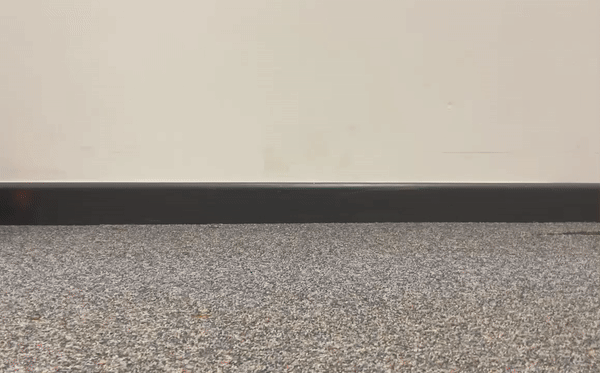

# AGV_RCCar 🏎️

## 📖 Beschrijving

Het **AGV** project is een geavanceerd embedded systeem dat een RC-car transformeert in een autonoom geleid voertuig. Het systeem is ontworpen voor dual-mode operatie:
- **Manuele Modus:** Real-time besturing via een draadloze Bluetooth-verbinding.
- **Autonome Modus:** Zelfstandige navigatie middels line-tracking en actieve obstakelvermijding via ultrasone sensoren.

De kernwaarde van dit project ligt in de ontwikkeling van een **cross-platform firmware-architectuur**. Hierdoor kunnen verschillende types hardware-onderstellen aangestuurd worden met een uniforme logische basis, wat zorgt voor herbruikbaarheid en schaalbaarheid.

## ⚙️ Technische Stack

| Component | Technologie |
|:--- |:--- |
| **Microcontrollers** | PSoC6, ESP32, Arduino |
| **Motor Drivers** | MD22, Sabertooth 2x32A |
| **Ontwikkelomgeving** | ModusToolbox™ (Infineon) |
| **Programmeertaal** | C (Embedded) |
| **Sensoren** | Ultrasonic (HC-SR04), Line Tracking Array |

---

## 🚀 Sequence of Operation

Volg deze stappen om het systeem operationeel te maken nadat de hardware is geassembleerd:

1. **Power-up:** Verbind het bord via USB met een host-computer of voed de batterij.
2. **Systeemstatus:** De groene LED licht op als indicator dat de firmware succesvol is geïnitialiseerd.
3. **Communicatie:** Open een seriële terminal (bijv. de ModusToolbox Terminal) om het welkomstbericht en debugging-data te bekijken.
4. **Kalibratie:** 

---

## 🛠️ Aan de slag

Volg deze stappen om de code te builden en te flashen naar de hardware:

### Prerequisites
* ModusToolbox™ 3.x geïnstalleerd.
* Juiste Board Support Packages (BSP) voor de gebruikte PSoC6 CY8CKIT-062-WIFI-BT/CY8CPROTO-062-4343W.

### Project Setup & Build
1. **Project importeren:**
   Open ModusToolbox en importeer de gewenste workspace uit de repository: `AutoKit` of `RC_CarT`.
2. **Build & Flash:**
   - Voer een `Clean` en `Build` uit om de project-dependencies te compileren.
   - Gebruik de `Program` tool om de firmware naar de microcontroller te schrijven.

---

## 📊 Resultaten & Status

### Huidige Status
- [x] **Hardware:** Ontwerp en assemblage voltooid.
- [x] **PCB:** Productie en component-populatie succesvol.
- [x] **Firmware:** Basis abstractielaag en motor-aansturing operationeel.

---

## 📂 Documentatie

Uitgebreide technische details zijn beschikbaar in de `/docs` directory:
- [📄 Design Document](./docs/design.md) - Architectuur en schema's.
- [📘 User Manual](./docs/user-manual.md) - Gebruikersinstructies.

---

## 👥 Team

- **Anish Pun** [@Anish-Pun](https://github.com/Anish-Pun) – *Software Architecture*
- **Joel Akem** [@jjoellie](https://github.com/jjoellie) – *Firmware Development*
- **Kaelig Guillemette** [@guikae06](https://github.com/guikae06) – *Hardware Engineering*

---
