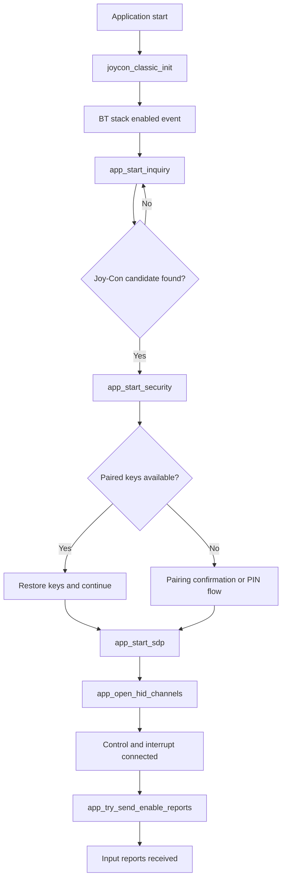

# Bluetooth in the Joy-Con Host Project

## Overview
This document explains how Bluetooth is used in the project at application level, with the focus on the host implementation in `joycon_classic.c`.  The application initializes the Bluetooth host once and then services the connection state continuously from the main task by calling `joycon_classic_process()` every 10 ms. 

## Main entry points
The public interface of the module is intentionally small and consists of `joycon_classic_init()` and `joycon_classic_process()`. `joycon_classic_init()` initializes the Bluetooth platform and starts the WICED stack, while `joycon_classic_process()` drives retries, security restarts, inquiry scheduling, and periodic keepalive behavior during runtime. 

## Important internal functions
The most important internal functions in `joycon_classic.c` are `app_bt_management_callback()`, `app_start_inquiry()`, `app_start_security()`, `app_start_sdp()`, `app_open_hid_channels()`, `app_try_send_enable_reports()`, `app_send_subcommand_03()`, and `app_l2cap_data_ind_cb()`.  Together, these functions cover the complete Bluetooth path from stack events and device discovery to pairing, channel setup, report-mode configuration, and incoming input parsing. 

## Startup behavior
During startup, the application initializes the board, UART logging, motor module, and LED module before calling `joycon_classic_init()`. After the Bluetooth stack reports `BTM_ENABLED_EVT`, the management callback marks Bluetooth as enabled and schedules device inquiry, which starts the search for a Joy-Con candidate. 

## Discovery and identification
The implementation contains explicit Joy-Con candidate checks through `app_is_joycon_candidate()`, `app_name_looks_like_joycon()`, and `app_remote_name_looks_like_joycon()`.  This means the discovery logic does not blindly connect to any nearby Bluetooth device, but instead filters devices by class and by name-related information before proceeding. 

## Pairing and reconnection
Security handling is centralized in `app_bt_management_callback()` and `app_start_security()`.  The code stores local identity keys and paired BR/EDR link keys, restores saved keys when possible, accepts user confirmation requests, and answers legacy PIN requests with `0000`, which supports reconnecting to a previously paired controller without repeating the full pairing sequence every time. 

## HID channel setup
After discovery and security succeed, the code continues with SDP and then opens two L2CAP channels through `app_open_hid_channels()`.  These are the HID control channel on PSM `0x0011` and the HID interrupt channel on PSM `0x0013`, which together form the transport used for Joy-Con report exchange. 

## Input activation
Once both channels are connected, `app_try_send_enable_reports()` calls `app_send_subcommand_03()` to send subcommand `0x03` with value `0x30` over the control channel.  That request enables the standard full input report mode used later by `app_l2cap_data_ind_cb()` to parse button data, hat direction, and analog stick values from incoming reports. 

## Interaction with the rest of the project
When the first valid input changes arrive, the Bluetooth module marks the LED as input-ready by calling `joycon_status_led_set_input_ready()`.   Hat-direction changes are forwarded to `joycon_drive_logic_handle_hat()`, which maps selected directional inputs to motor commands such as forward, left, right, or stop.   

## Supported functionality
The current implementation supports Joy-Con discovery, pairing or key restoration, HID control and interrupt channel setup, enabling standard full input report mode, parsing button and stick data, handling hat-direction based drive control, and reconnect attempts after disconnects.   It also provides a connection-state LED, UART debug logging, and a software keepalive that resends the input-mode subcommand while the session is active. 

## Not supported or not shown
The current code does not show support for sending rumble effects, reading IMU sensor data, handling SPI memory access, battery reporting, NFC or IR features, or advanced Joy-Con configuration commands beyond the input-mode request.  The transmitted subcommand packet includes rumble placeholder bytes, but they are filled with zeros rather than dynamically controlled vibration data. 

## Discovery and pairing flow

This flow matches the structure of the implementation, where inquiry, security, SDP, L2CAP setup, and input activation are performed in sequence with retries when needed. 
