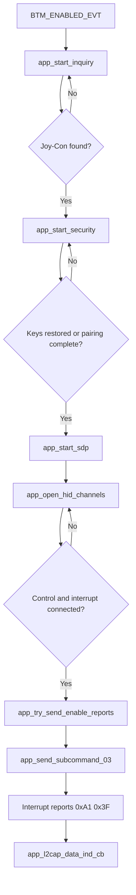

# Bluetooth Protocol Used by the Joy-Con Host

## Overview
This document describes the protocol flow implemented in `joycon_classic.c`, with emphasis on the key functions that move the connection from discovery to active input processing.  The implementation uses a BR/EDR HID-style connection built on inquiry, security, SDP, and two L2CAP channels for control and interrupt traffic. 

## Key functions in the protocol path
The core protocol path is distributed across `joycon_classic_init()`, `joycon_classic_process()`, `app_bt_management_callback()`, `app_start_inquiry()`, `app_start_security()`, `app_start_sdp()`, `app_open_hid_channels()`, `app_try_send_enable_reports()`, `app_send_subcommand_03()`, and `app_l2cap_data_ind_cb()`.  These functions are the most useful ones to mention in documentation because they align directly with the major protocol phases a reader expects to understand. 

## Protocol phases
The protocol sequence implemented by the code is: stack initialization, Joy-Con candidate discovery, pairing or key restoration, SDP service discovery, L2CAP HID channel setup, report-mode activation, and continuous input-report processing.  `joycon_classic_process()` keeps that sequence alive over time by handling delayed retries for inquiry and security, and by sending periodic keepalive traffic once the session is established. 

## Discovery phase
Discovery begins after `BTM_ENABLED_EVT` is received inside `app_bt_management_callback()`.  Candidate evaluation is supported by `app_is_joycon_candidate()`, `app_name_looks_like_joycon()`, and `app_remote_name_looks_like_joycon()`, which suggests the host checks both class information and Joy-Con-related name information before selecting a target device. 

## Security phase
The security phase is handled through Bluetooth management events and `app_start_security()`.  The code stores and restores BR/EDR link keys, stores local identity keys, confirms user-confirmation requests, and answers legacy PIN requests with `0000`, so both first-time pairing and later reconnection are supported by the implementation. 

## SDP phase
The code allocates a 1024-byte SDP discovery database and defines `app_bt_sdp_complete_cb()` as the callback for SDP completion.  In protocol terms, SDP is the step that bridges pairing and transport setup by preparing the host to open the appropriate HID communication channels on the remote controller. 

## L2CAP transport phase
The L2CAP transport layer is opened through `app_open_hid_channels()` and monitored through `app_l2cap_connected_cb()`, `app_l2cap_disconnect_ind_cb()`, and `app_l2cap_disconnect_cfm_cb()`.  The implementation uses two HID-related PSM values, `0x0011` for the control path and `0x0013` for the interrupt path, and the project configuration reserves exactly two application L2CAP channels for this design. 

## Report activation phase
When both channels are active, `app_try_send_enable_reports()` calls `app_send_subcommand_03()`.  That function sends a packet beginning with `0xA2`, report ID `0x01`, and subcommand `0x03` with value `0x30`, which requests the standard full input report mode used by the rest of the host logic. 

## Input report phase
`app_l2cap_data_ind_cb()` parses interrupt-channel packets that begin with `0xA1` and report ID `0x3F`.  For those frames, the code extracts button bytes, hat direction, and analog stick values, updates cached input state, marks the LED as ready, and forwards hat changes to the drive logic layer.   

## Supported protocol behavior
The implemented protocol behavior includes discovery, pairing or key restore, HID control and interrupt transport setup, subcommand-based report-mode activation, repeated keepalive transmission, disconnect cleanup, and reconnection attempts.  At application level, the received hat input is used to drive motor control behavior, and the status LED indicates connecting versus input-ready states.   

## Unsupported or unimplemented behavior
The current protocol implementation does not show support for richer Joy-Con subcommands such as motion sensor configuration, SPI reads or writes, battery queries, player LEDs, NFC or IR features, or active rumble control.  Although the outbound report format reserves rumble bytes, the code sends zero-filled placeholders instead of real vibration commands. 

## Flowchart

This diagram gives a compact view of the protocol path that is already present in the implementation and highlights the key function names that a reader can trace back into `joycon_classic.c`. 
