# System Design

## 1. System Overview

This project implements firmware for a 4-wheeled RC car running on an Infineon PSoC6 microcontroller. The system supports two vehicles and two operating modes.

### Vehicles

| Vehicle | Board | Status |
|---|---|---|
| RC Car | CY8CKIT-062-WIFI-BT (Pioneer Kit) | Implemented |
| RC Cart (AGV) | CY8CPROTO-062-4343W (Proto Kit) | Not implemented yet |

### Operating Modes (RC Car)

| Mode | Trigger | Description |
|---|---|---|
| Bluetooth / Manual | Default on boot | Driver controls the car via Nintendo Joy-Con over BR/EDR HID |
| Self-driving | Joy-Con button (`btn0 = 0x08 / Y `) | Car navigates autonomously using ultrasonic sensors and IMU |

---

## 2. Hardware Design

### RC Car Schematic

This schematic shows the internal electronics of the RC car including the microcontroller, motor drivers, and sensors.

### RC Cart Schematic (AGV)

This schematic shows the electronic layout of the RC cart module and how it interfaces with the control system. *(Not implemented yet)*

---

## 3. Pin Mapping

All GPIO assignments are defined in `common/pins.h`.

| Peripheral | Signal | Pin |
|---|---|---|
| UART TX (debug) | TX | P5_1 |
| UART RX (debug) | RX | P5_0 |
| Motor A | PWM | P10_0 |
| Motor B | PWM | P10_1 |
| Motor C | PWM | P10_2 |
| Motor D | PWM | P10_3 |
| Ultrasonic Right | Trigger | P9_0 |
| Ultrasonic Right | Echo | P9_1 |
| Ultrasonic Left | Trigger | P9_4 |
| Ultrasonic Left | Echo | P9_5 |
| IMU SDA | I²C data | P6_1 |
| IMU SCL | I²C clock | P6_0 |
| IMU Interrupt | GPIO IRQ | P10_5 |
| Encoder Right | GPIO IRQ | P9_6 |
| Encoder Left | GPIO IRQ | P9_7 |
| Start/Stop SW2 | GPIO input | P0_4 |
| Status LED | GPIO output | P13_7 |

---

## 4. Power Design

| Rail | Source | Powers |
|---|---|---|
| PSoC6 logic | USB powerbank | PSoC6 MCU, Bluetooth chip |
| Motor + sensor rail | 4× AA battery (6V) / USB powerbank | L298N motor driver, DC motors, HC-SR04 sensors, IMU |

---

## 5. Full System Flowchart

```mermaid
flowchart TD

    %% ── BOOT ────────────────────────────────────────────────
    subgraph BOOT["🟦 Boot"]
        A([main.c]) --> B[BSP init · UART · IRQ enable]
        B --> C{Target board?}
    end

    C -- Pioneer Kit --> RTOS_GROUP
    C -- Proto Kit   --> CART

    CART(["⬜ RC Cart AGV\nnot implemented yet"])

    %% ── RC CAR LOGIC + RTOS ─────────────────────────────────
    subgraph RTOS_GROUP["🟪 RC Car Logic · FreeRTOS"]
        D[rc_car_logic_init · run]
        D --> E[FreeRTOS JoyCon task created]
        E --> F[motor_init · motor_stop]
        F --> G[joycon_status_led_init\nLED → blinking]
        G --> H[joycon_classic_init]
    end

    %% ── BLUETOOTH ───────────────────────────────────────────
    subgraph BT_GROUP["🟩 Bluetooth Stack · joycon_classic.c"]
        H --> I[BTM_ENABLED_EVT]
        I --> J[app_start_inquiry]
        J --> K{Joy-Con\ncandidate found?}
        K -- No  --> J
        K -- Yes --> L[app_start_security]
        L --> M{Paired keys\navailable?}
        M -- Yes --> N[Restore link keys]
        M -- No  --> O[Pairing · PIN 0000 · auto-confirm]
        N --> P[app_start_sdp]
        O --> P
        P --> Q[app_open_hid_channels\nPSM 0x0011 · 0x0013]
        Q --> R{Control + interrupt\nconnected?}
        R -- No  --> Q
        R -- Yes --> S[app_try_send_enable_reports\nsubcommand 0x03 · value 0x30]
        S --> T[Input reports 0xA1 0x3F arriving]
        T --> U[app_l2cap_data_ind_cb\nparse btn0 · hat · sticks]
        U --> V[joycon_status_led_set_input_ready\nLED → solid on]
    end

    %% ── MODE SWITCH ─────────────────────────────────────────
    subgraph MODE["🔀 Mode Switch · btn0"]
        U --> MA{btn0 = Y / 0x08?}
        MA -- Yes --> MB[rc_car_logic_set_mode\nSELF_DRIVING]
        MA -- No  --> MC{btn0 = B /0x04?}
        MC -- Yes --> MD[rc_car_logic_set_mode\nBLUETOOTH]
        MC -- No  --> ME{btn0 =  X / 0x02\nand halted?}
        ME -- Yes --> MF[self_driving_enter\nrestart]
        ME -- No  --> MG{Self-driving\nactive?}
        MG -- Yes --> MH[Skip hat input\nself-driving controls motors]
        MG -- No  --> MI[joycon_drive_logic_handle_hat]
    end

    %% ── MANUAL DRIVING ──────────────────────────────────────
    subgraph MANUAL["🟦 Bluetooth / Manual Mode"]
        MI --> HA{hat value}
        HA -- 0x00           --> HAA[motor_forward 100%]
        HA -- 0x01 / 0x02   --> HAB[motor_turn_left 100%]
        HA -- 0x06 / 0x07   --> HAC[motor_turn_right 100%]
        HA -- other          --> HAD[motor_stop]
    end

    HAA --> U
    HAB --> U
    HAC --> U
    HAD --> U
    MD  --> U

    %% ── SELF-DRIVING ────────────────────────────────────────
    subgraph SD_INIT["🟧 Self-Driving Init"]
        MB  --> SD0{First time?}
        SD0 -- Yes --> SD1[ultrasonic_init\nimu_init · speed_init]
        SD0 -- No  --> SD2
        SD1 --> SD2[self_driving_enter]
        SD2 --> SD3[Clear Motion_Detected\nreset encoders]
        SD3 --> SD4[Capture IMU baseline\nax · ay · az]
        SD4 --> SD5[motor_forward 65%]
    end

    subgraph SD_LOOP["🟧 self_driving_step · every 50 ms"]
        SD5 --> L1[imu_read_all\nax ay az gx gy gz]
        L1  --> L2[get_distance_right_cm\nget_distance_left_cm]
        L2  --> L3[get_speed_right/left_kmh\nencoder counts]
        L3  --> L4[Update terminal\nlines 2 · 3 · 4 in-place]

        L4  --> C1{halted_until\nrestart?}
        C1 -- Yes --> C1A[motor_stop\nprint halt · delay 50ms]
        C1A --> L1

        C1 -- No  --> C2{IMU delta\nthreshold x3?}
        C2 -- Yes --> C2A[motor_stop\nhalted · LIFT DETECTED]
        C2A --> L1

        C2 -- No  --> C3{Both sensors\nlt 18 cm?}
        C3 -- Yes --> C3A[motor_stop\nhalted · BOTH OBSTACLES]
        C3A --> L1

        C3 -- No  --> C4{Right sensor\nlt 25 cm?}
        C4 -- Yes --> C4A[motor_turn_left 70%]
        C4A --> L1

        C4 -- No  --> C5{Left sensor\nlt 25 cm?}
        C5 -- Yes --> C5A[motor_turn_right 70%]
        C5A --> L1

        C5 -- No  --> C6[motor_forward 80%\nsoft-start ramp]
        C6 --> L1
    end

    MF --> SD2

    %% ── STYLE ───────────────────────────────────────────────
    classDef boot     fill:#3b5bdb,stroke:#3b5bdb,color:#fff,rx:8
    classDef rtos     fill:#6741d9,stroke:#6741d9,color:#fff,rx:8
    classDef bt       fill:#0ca678,stroke:#0ca678,color:#fff,rx:8
    classDef manual   fill:#1971c2,stroke:#1971c2,color:#fff,rx:8
    classDef sd       fill:#e8590c,stroke:#e8590c,color:#fff,rx:8
    classDef decision fill:#f08c00,stroke:#f08c00,color:#fff,rx:8
    classDef stub     fill:#868e96,stroke:#868e96,color:#fff,rx:8

    class A,B boot
    class D,E,F,G,H rtos
    class I,J,L,N,O,P,Q,S,T,U,V bt
    class MI,HA,HAA,HAB,HAC,HAD manual
    class SD1,SD2,SD3,SD4,SD5,L1,L2,L3,L4,C1A,C2A,C3A,C4A,C5A,C6 sd
    class C,K,M,R,MA,MC,ME,MG,SD0,C1,C2,C3,C4,C5 decision
    class CART stub
```

