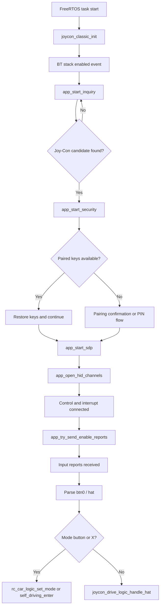

# Bluetooth in the Joy-Con Host Project

## Overview
This document explains how Bluetooth is used in the project at application level, with the focus on the host implementation in `joycon_classic.c`.  The application initializes the Bluetooth host once and then services the connection state continuously from the main task by calling `joycon_classic_process()` every 10 ms. 

## Source location
`joycon_classic.c` is located under `rc_car/joycon/`. The Bluetooth debug helper `app_bt_utils.c` is located under `common/`.

## Main entry points
The public interface consists of `joycon_classic_init()` and `joycon_classic_process()`. `joycon_classic_init()` initializes the Bluetooth platform and starts the WICED stack. `joycon_classic_process()` drives retries, security restarts, inquiry scheduling, keepalive behavior, and mode-switch button handling during runtime.

## Important internal functions
The most important internal functions in `joycon_classic.c` are `app_bt_management_callback()`, `app_start_inquiry()`, `app_start_security()`, `app_start_sdp()`, `app_open_hid_channels()`, `app_try_send_enable_reports()`, `app_send_subcommand_03()`, and `app_l2cap_data_ind_cb()`. Together these cover the complete Bluetooth path from stack events and device discovery to pairing, channel setup, report-mode configuration, and incoming input parsing.

## Startup behavior
The FreeRTOS task initializes the motor layer and status LED before calling `joycon_classic_init()`. After the Bluetooth stack reports `BTM_ENABLED_EVT`, the management callback marks Bluetooth as enabled and schedules device inquiry, which starts the search for a Joy-Con candidate.

## Discovery and identification
The implementation filters inquiry results through `app_is_joycon_candidate()`, `app_name_looks_like_joycon()`, and `app_remote_name_looks_like_joycon()`. The host does not blindly connect to any nearby Bluetooth device — it checks both device class (peripheral CoD + HID UUID) and name-related information before proceeding.

## Pairing and reconnection
Security handling is centralized in `app_bt_management_callback()` and `app_start_security()`. The code stores and restores BR/EDR link keys and local identity keys, auto-confirms user-confirmation requests, and answers legacy PIN requests with `0000`. This supports reconnecting to a previously paired controller without repeating the full pairing sequence.

## HID channel setup
After discovery and security succeed, the code runs SDP then opens two L2CAP channels through `app_open_hid_channels()`:
- HID control channel on PSM `0x0011`
- HID interrupt channel on PSM `0x0013`

## Input activation
Once both channels are connected, `app_try_send_enable_reports()` calls `app_send_subcommand_03()` to send subcommand `0x03` with value `0x30` over the control channel, enabling standard full input report mode.

## Input handling and mode buttons
When valid input arrives, `app_l2cap_data_ind_cb()` parses button bytes and hat direction. Three button actions are handled in `btn0`:

| Mask | Action |
|---|---|
| `0x08 ( Y )` | Switch to self-driving mode |
| `0x04 ( B )` | Switch to Bluetooth/manual mode |
| `0x02 ( X )` | Button to restart self-driving if car is halted |

The X button restart only fires when `rc_car_logic_is_self_driving_active()` AND `self_driving_is_halted()` are both true. Hat direction changes are forwarded to `joycon_drive_logic_handle_hat()` only when self-driving is not active. All button presses are edge-detected to fire exactly once per press.

## LED feedback
The status LED on P13_7 blinks while the controller is connecting and switches to solid on when the first valid input report arrives, giving clear visual feedback of the connection state.

## Keepalive
While in input-report mode, `joycon_classic_process()` re-sends subcommand `0x03` every 100 ticks (~1 s) to maintain the active session.

## Disconnect and reconnect
On L2CAP disconnect, channel IDs are cleared, drive logic is reset via `joycon_drive_logic_reset()`, the LED returns to blinking, and `app_start_security()` is called again automatically if the Joy-Con BD address is still known.

## Not supported
Rumble effects (placeholder bytes only), IMU subcommands, SPI memory access, battery reporting, player LEDs, NFC, IR features, and analog stick driving.

## Discovery and pairing flow
