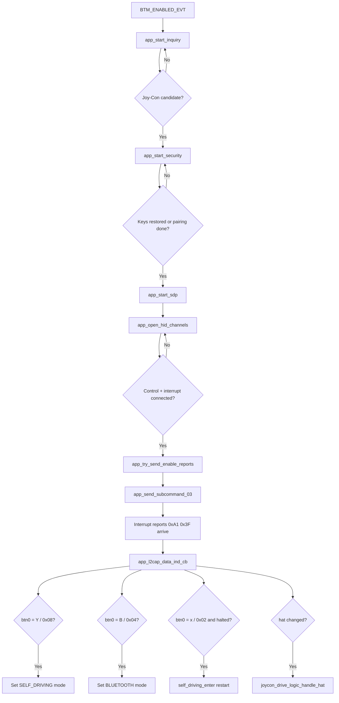

# Bluetooth Protocol Used by the Joy-Con Host

## Overview
This document describes the protocol flow implemented in `joycon_classic.c`, with emphasis on the key functions that move the connection from discovery to active input processing. The implementation uses a BR/EDR HID-style connection built on inquiry, security, SDP, and two L2CAP channels for control and interrupt traffic.

## Source location
`joycon_classic.c` is located under `rc_car/joycon/`.

## Key functions in the protocol path
The core protocol path is distributed across `joycon_classic_init()`, `joycon_classic_process()`, `app_bt_management_callback()`, `app_start_inquiry()`, `app_start_security()`, `app_start_sdp()`, `app_open_hid_channels()`, `app_try_send_enable_reports()`, `app_send_subcommand_03()`, and `app_l2cap_data_ind_cb()`. These functions align directly with the major protocol phases.

## Protocol phases
The protocol sequence is: stack initialization → Joy-Con candidate discovery → pairing or key restoration → SDP service discovery → L2CAP HID channel setup → report-mode activation → continuous input-report processing. `joycon_classic_process()` keeps the sequence alive by handling delayed retries for inquiry and security, and by sending periodic keepalive traffic once the session is established.

## Phase 1 — Stack initialization
`joycon_classic_init()` initializes the WICED BT platform. When the stack reports `BTM_ENABLED_EVT` inside `app_bt_management_callback()`, the `bt_enabled` flag is set and `app_start_inquiry()` is scheduled. The device presents itself as `PSoC6-JoyConHost`.

## Phase 2 — Discovery
`app_start_inquiry()` launches a BR/EDR general inquiry. Each result is evaluated by `app_is_joycon_candidate()` which checks CoD major class (peripheral) and HID UUID in EIR data. If matched, the EIR name is checked by `app_name_looks_like_joycon()`. If the name is not in the EIR, an async remote-name request is issued and evaluated in `app_bt_remote_name_cb()`. Name comparison is case-insensitive.

## Phase 3 — Security
`app_start_security()` calls `wiced_bt_dev_sec_bond()`. The management callback handles:

| Event | Handling |
|---|---|
| `BTM_PAIRED_DEVICE_LINK_KEYS_UPDATE_EVT` | Store link keys |
| `BTM_PAIRED_DEVICE_LINK_KEYS_REQUEST_EVT` | Restore stored keys |
| `BTM_LOCAL_IDENTITY_KEYS_UPDATE_EVT` | Store local identity keys |
| `BTM_LOCAL_IDENTITY_KEYS_REQUEST_EVT` | Restore local identity keys |
| `BTM_USER_CONFIRMATION_REQUEST_EVT` | Auto-confirm |
| `BTM_PIN_REQUEST_EVT` | Reply with PIN `"0000"` |
| `BTM_PAIRING_COMPLETE_EVT` | Mark paired, proceed to SDP |

On reconnection with stored keys, the key-restore path skips full pairing and proceeds directly to SDP.

## Phase 4 — SDP
`app_start_sdp()` allocates a 1024-byte SDP discovery database and initiates service discovery. `app_bt_sdp_complete_cb()` is called on completion and triggers `app_open_hid_channels()`.

## Phase 5 — L2CAP transport
`app_open_hid_channels()` opens two connections:

| Channel | PSM | Purpose |
|---|---|---|
| HID Control | `0x0011` | Outbound subcommands |
| HID Interrupt | `0x0013` | Inbound input reports |

MTU is 672 bytes. Both channels must be confirmed via `app_l2cap_connected_cb()` before proceeding.

## Phase 6 — Report activation
Once both channels are up, `app_try_send_enable_reports()` fires once and calls `app_send_subcommand_03()`:

```
Byte  Value  Meaning
0     0xA2   BT HID output report prefix
1     0x01   Output report ID
2     0x00   Packet counter
3–6   0x00   Rumble left (unused)
7–10  0x00   Rumble right (unused)
11    0x03   Subcommand: set input report mode
12    0x30   Standard full input report mode
```

## Phase 7 — Input report processing
`app_l2cap_data_ind_cb()` processes packets starting with `0xA1 0x3F` on the interrupt channel:

| Offset | Field | Action |
|---|---|---|
| `[2]` | `btn0` | Mode switch + X button restart |
| `[3]` | `btn1` | Button byte 1 |
| `[4] & 0x0F` | `hat` | → `joycon_drive_logic_handle_hat()` |
| `[5]`, `[7]` | `lx`, `ly` | Left stick (logged) |
| `[9]`, `[11]` | `rx`, `ry` | Right stick (logged) |

Button handling in `btn0`:

| Mask | Action |
|---|---|
| `0x08 ( Y )` | `rc_car_logic_set_mode(RC_CAR_MODE_SELF_DRIVING)` |
| `0x04 ( B )` | `rc_car_logic_set_mode(RC_CAR_MODE_BLUETOOTH)` |
| `0x02 ( X )` | `self_driving_enter()` if halted (X button restart) |

All button actions are edge-detected (XOR with previous `btn0`) so each press fires exactly once.

## Runtime — keepalive and retries
`joycon_classic_process()` is called every ~10 ms and handles inquiry retry ticks, security retry ticks, and re-sending subcommand `0x03` every 100 ticks while the session is active.

## Disconnect and reconnect
On `app_l2cap_disconnect_ind_cb()` or `app_l2cap_disconnect_cfm_cb()`, CIDs are cleared, `joycon_drive_logic_reset()` stops the motors, the LED returns to blinking, and `app_start_security()` is called again if the Joy-Con address is still known.

## Protocol flowchart


## Not implemented
Rumble (placeholder only), IMU subcommands, SPI reads, battery queries, player LEDs, NFC, IR features.