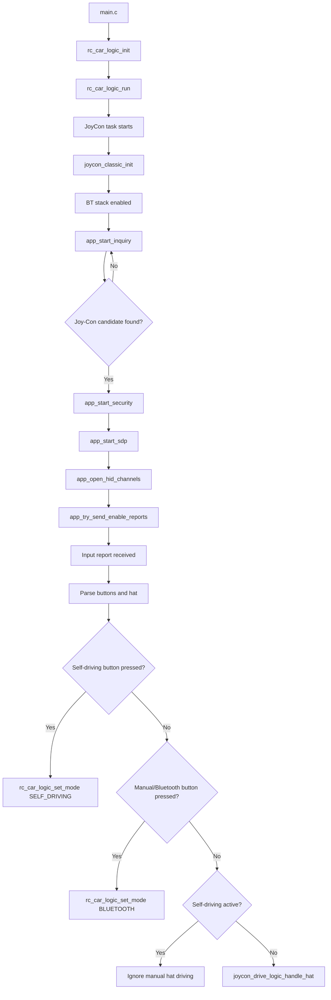

# Joy-Con Subsystem

## Overview
The Joy-Con subsystem provides Bluetooth-based manual control for the RC car and also acts as the user interface for switching between manual driving and self-driving operation. It combines Bluetooth discovery and pairing, HID communication, input decoding, status indication, and driving commands into one integrated subsystem.

## Scope
This document describes the full Joy-Con path in the firmware, including startup, Bluetooth communication, mode switching, LED feedback, and interaction with the motor and RC car control layers. It focuses on how the implementation works in the current codebase.

## Runtime position
The firmware starts in `main.c`, initializes the board and UART logging, and then hands control to `rc_car_logic_init()` and `rc_car_logic_run()` for the supported RC car board configuration. Inside `rc_car_logic_run()`, a FreeRTOS task is created, and that task initializes the motors, the Joy-Con status LED, and the Joy-Con Bluetooth host before entering the main runtime loop.

## Main modules
The Joy-Con subsystem is built from five main source files.

- `joycon_classic.c` implements Bluetooth stack startup, Joy-Con discovery, pairing, SDP, L2CAP channel setup, report activation, input decoding, and mode-switch button handling.
- `app_bt_utils.c` provides helper functions for readable Bluetooth logs, such as event names, advertising mode names, disconnect reasons, and status names.
- `joycon_drive_logic.c` translates selected Joy-Con hat directions into motor actions for manual driving.
- `joycon_status_led.c` manages a single status LED that blinks during connection setup and stays on once input is active.
- `rc_car_logic.c` connects the Joy-Con subsystem to the rest of the application and controls whether the car is in Bluetooth/manual mode or self-driving mode.

## Public entry points
The public API for the Bluetooth host side is intentionally small and consists of `joycon_classic_init()` and `joycon_classic_process()`. `joycon_classic_init()` initializes the Bluetooth platform and starts the WICED stack, while `joycon_classic_process()` services retries, delayed work, and keepalive behavior during runtime. At the application level, `rc_car_logic_set_mode()`, `rc_car_logic_get_mode()`, and `rc_car_logic_is_self_driving_active()` allow the broader system to switch and query the current operating mode.

## Startup sequence
The runtime sequence begins with board initialization and UART setup in `main.c`. The RC car task then initializes the motor layer, stops the motors, initializes the LED, sets the LED to connecting mode, and starts the Joy-Con Bluetooth host through `joycon_classic_init()`. After that, the task continuously calls `joycon_classic_process()` and `joycon_status_led_process()`, and only calls `self_driving_step()` when self-driving mode is active.

## Bluetooth host behavior
The Bluetooth host logic is implemented in `joycon_classic.c` using the WICED Bluetooth stack and related management, SDP, and L2CAP APIs. The configured device name is `PSoC6-JoyConHost`, and the implementation is structured as a host that searches for a Joy-Con candidate, secures the connection, opens HID channels, and then processes incoming controller reports.

## Important functions in `joycon_classic.c`
The most important internal functions are `app_bt_management_callback()`, `app_start_inquiry()`, `app_start_security()`, `app_start_sdp()`, `app_open_hid_channels()`, `app_try_send_enable_reports()`, `app_send_subcommand_03()`, and `app_l2cap_data_ind_cb()`. Together, these functions implement the full controller connection path from Bluetooth startup to active input parsing.

## Discovery and candidate selection
After the Bluetooth stack reports `BTM_ENABLED_EVT`, the management callback marks Bluetooth as ready and schedules inquiry. Candidate filtering is done through helper logic such as `app_is_joycon_candidate()`, `app_name_looks_like_joycon()`, and `app_remote_name_looks_like_joycon()`, which indicates that the code checks both class-related and name-related information before continuing.

## Pairing and reconnection
Security handling is performed through management events and explicit security startup logic. The implementation stores local identity keys and paired BR/EDR link keys, restores keys for known devices, accepts user-confirmation requests, and replies to legacy PIN requests with `0000`, which supports reconnecting without repeating the full pairing flow every time.

## SDP and L2CAP channels
The code defines two HID-related PSM values: `0x0011` for the control channel and `0x0013` for the interrupt channel. An SDP discovery database of 1024 bytes is allocated before the code opens the L2CAP HID channels, which matches the expected sequence of service discovery followed by transport setup.

## Input report activation
Once both L2CAP channels are connected, `app_try_send_enable_reports()` calls `app_send_subcommand_03()`. That function sends a control-channel packet beginning with `0xA2`, report ID `0x01`, and subcommand `0x03` with value `0x30`, which requests the standard full input report mode used by the input parser.

## Input parsing
Incoming interrupt-channel data is handled in `app_l2cap_data_ind_cb()`. When the payload begins with `0xA1` and report ID `0x3F`, the code extracts button bytes, hat direction, and analog stick values from fixed offsets in the packet and updates its cached controller state. The module only reacts when the state changes, which avoids repeating the same actions on unchanged input frames.

## Manual driving behavior
Manual movement is driven through `joycon_drive_logic_handle_hat()` when self-driving mode is not active. In the current implementation, hat value `0x00` drives forward, values `0x06` and `0x07` turn right, values `0x02` and `0x01` turn left, and all other values stop the car. The manual driving layer uses a fixed PWM command of 100 for these actions.

## Mode switching
The Joy-Con subsystem also acts as the user input interface for switching operating modes. In `joycon_classic.c`, button changes are checked against `JOYCON_BTN_SELF_MASK` with value `0x08` and `JOYCON_BTN_MANUAL_MASK` with value `0x04`. A press on the self-driving button calls `rc_car_logic_set_mode(RC_CAR_MODE_SELF_DRIVING)`, while a press on the manual/Bluetooth button calls `rc_car_logic_set_mode(RC_CAR_MODE_BLUETOOTH)`.

## LED behavior
The status LED is connected to pin `P13_7` and is configured as active-low. While the controller is connecting, the LED blinks by toggling every 25 software ticks inside `joycon_status_led_process()`. Once valid input is received, `joycon_status_led_set_input_ready()` changes the LED to a steady on state.

## Logging helpers
`app_bt_utils.c` improves the readability of runtime logs by converting numeric Bluetooth values into readable strings. It includes helpers for printing Bluetooth device addresses and for naming management events, advertising modes, GATT disconnect reasons, and GATT status codes.

## Interaction with the RC car layer
`rc_car_logic.c` initializes the Joy-Con-related modules and decides whether manual or self-driving behavior should run in the main task loop. When the system enters self-driving mode for the first time, `rc_car_logic_set_mode()` initializes the ultrasonic, IMU, and speed modules, then calls `self_driving_enter()`. When the system returns to Bluetooth/manual mode, `rc_car_logic_set_mode()` calls `self_driving_exit()` if needed, stops the motors, and prints the mode change to the console.

## Hardware dependencies
The Joy-Con subsystem depends on the motor layer, the RC car logic layer, and the board-specific Bluetooth configuration. It also uses the PWM motor outputs indirectly through the manual drive logic and uses the LED output on `P13_7` for status indication.

## Supported functionality
The current implementation supports Joy-Con discovery, candidate filtering, pairing or key restoration, SDP, HID control and interrupt channel setup, input report activation, input parsing, manual drive commands from the hat switch, connection-state LED feedback, and mode switching between Bluetooth/manual and self-driving operation. It also supports UART-based debug logging with readable Bluetooth event names through the helper module.

## Limitations
The current Joy-Con implementation focuses on connection setup, input handling, manual driving, and mode switching. It does not currently implement extra Joy-Con features such as active rumble control, battery reporting, NFC or IR support, or analog-stick-based driving. Manual driving is limited to hat-direction input only.

## Discovery and control flow
