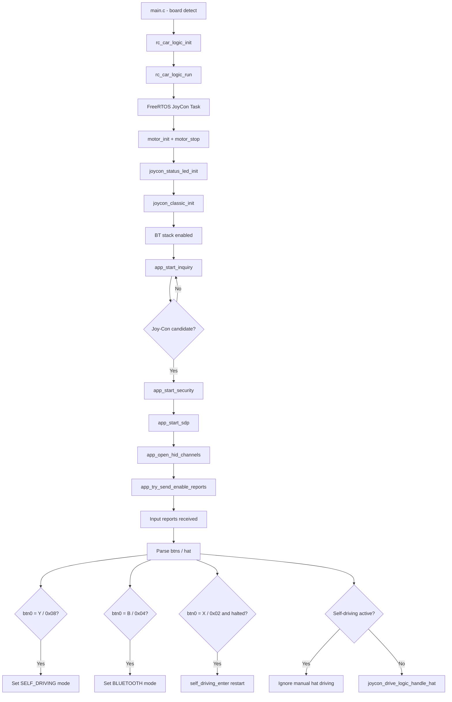

# Joy-Con Subsystem

## Overview
The Joy-Con subsystem provides Bluetooth-based manual control for the RC car and acts as the user interface for switching between manual driving and self-driving operation. It combines Bluetooth discovery and pairing, HID communication, input decoding, status indication, and driving commands into one integrated subsystem.

## Scope
This document describes the full Joy-Con path in the firmware, including startup, Bluetooth communication, mode switching, X button restart, LED feedback, and interaction with the motor and RC car control layers.

## Source location
The Joy-Con subsystem files are located under `rc_car/joycon/`:

```
rc_car/joycon/
    joycon_classic.c / .h     — Bluetooth stack, HID protocol, input parsing, mode switching
    joycon_drive_logic.c / .h — Hat input → motor commands
    joycon_status_led.c / .h  — Connection state LED
```

## Runtime position
The firmware starts in `main.c`, which detects the target board via preprocessor defines. On the CY8CKIT-062-WIFI-BT Pioneer Kit, it calls `rc_car_logic_init()` and `rc_car_logic_run()`. The proto kit variant (`CY8CPROTO-062-4343W`) is detected but not yet implemented. Inside `rc_car_logic_run()`, a FreeRTOS task is created that initializes motors, the status LED, and the Joy-Con Bluetooth host before entering the main loop.

## Main modules

| File | Responsibility |
|---|---|
| `joycon_classic.c` | Full Bluetooth host: discovery, pairing, SDP, L2CAP, input decoding, mode-switch buttons |
| `app_bt_utils.c` | Readable Bluetooth log helpers (event names, disconnect reasons, status codes) |
| `joycon_drive_logic.c` | Translates Joy-Con hat direction into `motor_*` calls for manual driving |
| `joycon_status_led.c` | Blinks LED while connecting, solid on when input is active |
| `rc_car_logic.c` | Owns operating mode state, creates FreeRTOS task, handles mode transitions |

## Public entry points
The Bluetooth host public API consists of `joycon_classic_init()` and `joycon_classic_process()`. At the application level, `rc_car_logic_set_mode()`, `rc_car_logic_get_mode()`, and `rc_car_logic_is_self_driving_active()` allow the broader system to switch and query the current operating mode.

## FreeRTOS task loop
The main task loop runs continuously:

```c
for (;;) {
    joycon_classic_process();       // BT input, retries, keepalive, mode buttons
    joycon_status_led_process();    // blink or hold LED

    if (mode == RC_CAR_MODE_SELF_DRIVING)
        self_driving_step();        // 50 ms sensor-decide-act cycle
    else
        vTaskDelay(10 ms);          // yield in BT mode
}
```

## Bluetooth host behavior
The Bluetooth host uses the WICED BR/EDR stack. The configured device name is `PSoC6-JoyConHost`. The host searches for a Joy-Con candidate, secures the connection, opens HID channels, activates input reports, and then processes controller input continuously.

## Important internal functions

| Function | Role |
|---|---|
| `app_bt_management_callback()` | Central BT event handler |
| `app_start_inquiry()` | Starts BR/EDR device inquiry |
| `app_is_joycon_candidate()` | Filters by device class and HID UUID |
| `app_name_looks_like_joycon()` | Validates EIR name fields |
| `app_start_security()` | Initiates pairing or key restoration |
| `app_start_sdp()` | SDP service discovery before channel setup |
| `app_open_hid_channels()` | Opens L2CAP control (0x0011) and interrupt (0x0013) |
| `app_try_send_enable_reports()` | Sends report-mode activation once both channels are up |
| `app_send_subcommand_03()` | Sends subcommand 0x03 / value 0x30 for full input report mode |
| `app_l2cap_data_ind_cb()` | Parses incoming HID reports, dispatches input and buttons |

## Input parsing
`app_l2cap_data_ind_cb()` processes interrupt-channel packets starting with `0xA1 0x3F`. Parsed fields:

| Byte | Field | Use |
|---|---|---|
| `[2]` | `btn0` | Mode-switch and restart buttons |
| `[3]` | `btn1` | Button byte 1 |
| `[4] & 0x0F` | `hat` | D-pad direction → drive logic |
| `[5]`,`[7]` | `lx`, `ly` | Left stick |
| `[9]`,`[11]` | `rx`, `ry` | Right stick |

## Mode switching buttons

| Button | `btn0` mask | Action |
|---|---|---|
| Self-driving button | `0x08` | `rc_car_logic_set_mode(RC_CAR_MODE_SELF_DRIVING)` |
| Manual/BT button | `0x04` | `rc_car_logic_set_mode(RC_CAR_MODE_BLUETOOTH)` |
| **X button** | **`0x02`** | **`self_driving_enter()` — restarts self-driving if halted** |

Button presses are edge-detected (XOR with previous `btn0`) so each press fires exactly once. The X button only fires when `rc_car_logic_is_self_driving_active()` AND `self_driving_is_halted()` are both true — it cannot accidentally switch modes during normal driving.

## Manual driving — hat mapping

| Hat value | Direction | Motor command |
|---|---|---|
| `0x00` | Up | `motor_forward(100)` |
| `0x01`, `0x02` | Up-right / Right | `motor_turn_left(100)` |
| `0x06`, `0x07` | Down-left / Left | `motor_turn_right(100)` |
| Other | Neutral | `motor_stop()` |

Hat input is only forwarded to drive logic when self-driving mode is not active.

## LED behavior

| State | LED |
|---|---|
| Connecting / searching | Blinking every 25 ticks |
| Input reports received | Solid on |

LED pin: P13_7 (active-low). Initialized in `joycon_status_led_init()`.

## Pairing and reconnection
The implementation stores and restores `wiced_bt_device_link_keys_t` and `wiced_bt_local_identity_keys_t`. Auto-confirms user-confirmation requests and answers legacy PIN requests with `"0000"`. Supports reconnection to a previously paired Joy-Con without repeating the full pairing flow.

## Keepalive
While in input-report mode, `joycon_classic_process()` re-sends subcommand `0x03` every 100 ticks (~1 s) to keep the session alive.

## Disconnect and reconnect
On L2CAP disconnect: channel IDs are cleared, drive logic is reset, LED returns to blinking, and `app_start_security()` is called again automatically if the Joy-Con BD address is still known.

## Limitations
No rumble (placeholder bytes only), no IMU subcommands, no SPI reads, no battery queries, no player LEDs, no NFC or IR. Manual driving uses hat direction only — no analog stick driving.

## Discovery and control flow
