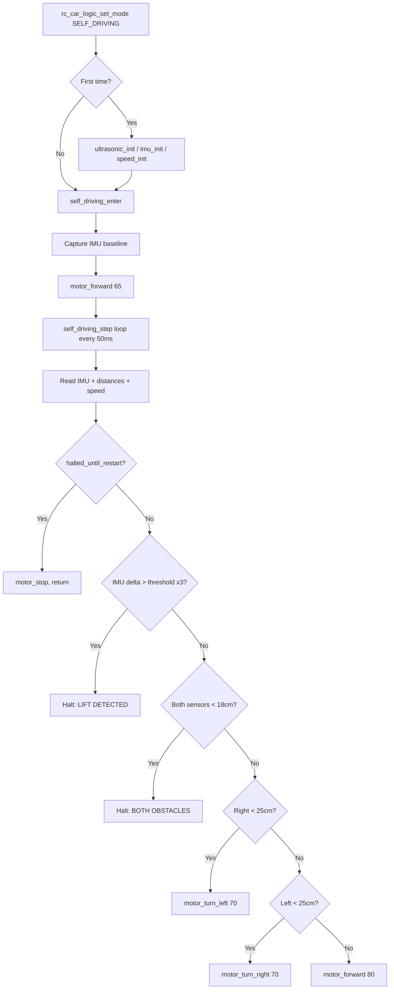

# Self-Driving Subsystem

## Overview
The self-driving subsystem provides autonomous obstacle-aware motion for the RC car using ultrasonic distance sensing, an MPU6050-based IMU, and wheel-encoder feedback. It is one of the two runtime modes of the RC car, alongside Bluetooth/manual control.

## Scope
This document explains how self-driving mode is initialized, which modules it uses, how `self_driving_step()` makes movement decisions, and which safety conditions stop the vehicle. It focuses on the implemented behavior in the firmware rather than planned autonomous features.

## Runtime position
The firmware enters self-driving mode through `rc_car_logic_set_mode(RC_CAR_MODE_SELF_DRIVING)`. On the first transition into this mode, `rc_car_logic.c` lazy-initializes the ultrasonic sensors, IMU module, and speed module, then calls `self_driving_enter()` and switches the global mode state to self-driving. Sensors are only initialized once — subsequent mode switches reuse the already-initialized peripherals.

## Main modules
The self-driving subsystem is composed of four main source files.

- `self_driving.c` contains the high-level autonomous control loop, movement decisions, IMU baseline detection, and halt state management.
- `ultrasonic.c` measures obstacle distance on the left and right sides using HC-SR04 sensors.
- `imu.c` initializes the MPU6050, enables motion interrupts, and reads accelerometer and gyroscope data.
- `speed.c` counts wheel encoder pulses and derives distance-based speed estimates for the left and right sides.

## Entry points

| Function | Description |
|---|---|
| `self_driving_enter()` | Resets state, captures IMU baseline, starts forward motion |
| `self_driving_exit()` | Stops motors, clears all state flags |
| `self_driving_step()` | One full sense-decide-act cycle, called every 50 ms |
| `self_driving_is_halted()` | Returns `true` when car is in persistent halt state |

## Enter behavior
When self-driving mode starts, `self_driving_enter()`:
- Clears `Motion_Detected` and resets wheel encoders
- Resets all halt flags and debounce counters
- Captures a live IMU reading as the **baseline** (`base_ax`, `base_ay`, `base_az`) — used later to detect lift relative to the car's actual starting orientation
- Clears the terminal and prints the status header
- Commands motors forward at 65%

## Exit behavior
`self_driving_exit()` stops the motors, clears halt flags and debounce counters, and prints an exit message.

## Control loop
`self_driving_step()` is called repeatedly from the RC car FreeRTOS task while the global mode is self-driving. Each cycle:

1. Reads IMU (ax, ay, az, gx, gy, gz)
2. Reads left and right ultrasonic distances
3. Reads encoder-based speed values
4. Updates terminal display (lines 2, 3, 4 in-place — no scrolling)
5. Checks halt state
6. Evaluates IMU lift/crash detection
7. Evaluates obstacle logic
8. Issues motor command
9. Delays 50 ms

## Terminal output
The subsystem writes three fixed lines to the terminal using ANSI escape codes, overwriting in place every cycle with no scrolling:

| Line | Content |
|---|---|
| Line 2 | Sensor status: distances, speeds, encoder counts, IMU axes, motion flag |
| Line 3 | Last event message (obstacle, lift, halt, clear path) |
| Line 4 | Full IMU read including gyro and baseline comparison values |

## IMU lift and crash detection
Rather than using a fixed absolute threshold, `self_driving_step()` compares each IMU read against the **baseline captured at startup** using delta values:

```
dAX = ax - base_ax
dAY = ay - base_ay
dAZ = az - base_az
```

If `|dAX| > 3000` or `|dAY| > 3000` or `|dAZ| > 2500`, a debounce counter (`imu_counter`) increments. The counter must reach **3 consecutive detections** before the car halts. This prevents single-bump false positives while still catching real lifts and crashes. The counter resets to 0 whenever values return to normal.

When triggered, the car enters `halted_until_restart` with an event message showing the delta values. The interrupt-based `Motion_Detected` flag is cleared each cycle as it was causing false positives on this hardware setup — the baseline delta approach is used instead.

## Halt state
`halted_until_restart` is a persistent flag set by both obstacle and IMU detection. While active:
- Motors are stopped every cycle
- The halt event message is printed once
- The step function returns immediately without running navigation logic
- The flag is only cleared by `self_driving_enter()` or `self_driving_exit()`

The X button on the Joy-Con (`btn0 = 0x02`) calls `self_driving_enter()` directly when the car is halted, restarting autonomous operation without switching modes.

## Obstacle handling

| Condition | Action |
|---|---|
| Both sensors < 18 cm | `motor_stop()`, enter `halted_until_restart` |
| Right sensor < 25 cm | `motor_turn_left(70)` |
| Left sensor < 25 cm | `motor_turn_right(70)` |
| Both clear | `motor_forward(80)` |

The halt threshold (18 cm) is tighter than the turn threshold (25 cm), giving a reaction zone before full stop.

## Ultrasonic sensing
The ultrasonic module uses two trigger/echo pairs:

| Sensor | Trigger | Echo |
|---|---|---|
| Right | P9_0 | P9_1 |
| Left | P9_4 | P9_5 |

Each reading sends a 10 µs trigger pulse, measures echo pulse duration in microseconds, and converts to centimetres using `duration × 0.0343 / 2`. Both trigger pins are held low and given 100 ms to settle after `ultrasonic_init()`. If the echo wait or pulse width exceeds 20 000 µs, the driver returns 1000 cm (treated as clear path).

## Speed estimation
The speed module uses wheel encoders on P9_6 (right) and P9_7 (left). Rising-edge GPIO interrupts increment `Count_EncoderRight` and `Count_EncoderLeft`. Speed is derived as:

```
distance_m = count / 235.0
speed_kmh  = distance_m × 3.6
```

This gives cumulative distance since the last `reset_encoders()` call expressed as a km/h equivalent, not instantaneous speed. Encoders are reset each time `self_driving_enter()` is called.

## Motor interaction
The self-driving subsystem uses the common motor layer:

| Function | Effect |
|---|---|
| `motor_forward(80)` | All 4 wheels forward at 80% |
| `motor_turn_left(70)` | Wheels A+C at 70%, B+D stopped |
| `motor_turn_right(70)` | Wheels B+D at 70%, A+C stopped |
| `motor_stop()` | All 4 wheels at 0% |

`motor_forward()` includes a soft-start ramp from 20% upward in 5% steps with 20 ms between each step, preventing inrush current spikes when all 4 motors start simultaneously on AA battery power.

## Supported functionality
Autonomous forward motion, obstacle avoidance on left and right sides, baseline-relative IMU lift and crash detection with 3-cycle debounce, in-place terminal diagnostics on 3 lines, persistent halt state with X button restart, encoder counting, mode entry and exit.

## Limitations
Simple rule-based controller with no path planning, mapping, or sensor fusion. No PID-based steering or closed-loop velocity control. Speed functions measure cumulative distance rather than instantaneous speed. The interrupt-based IMU motion flag is disabled due to hardware noise on this setup — baseline delta detection is used instead.

## Self-driving flow
