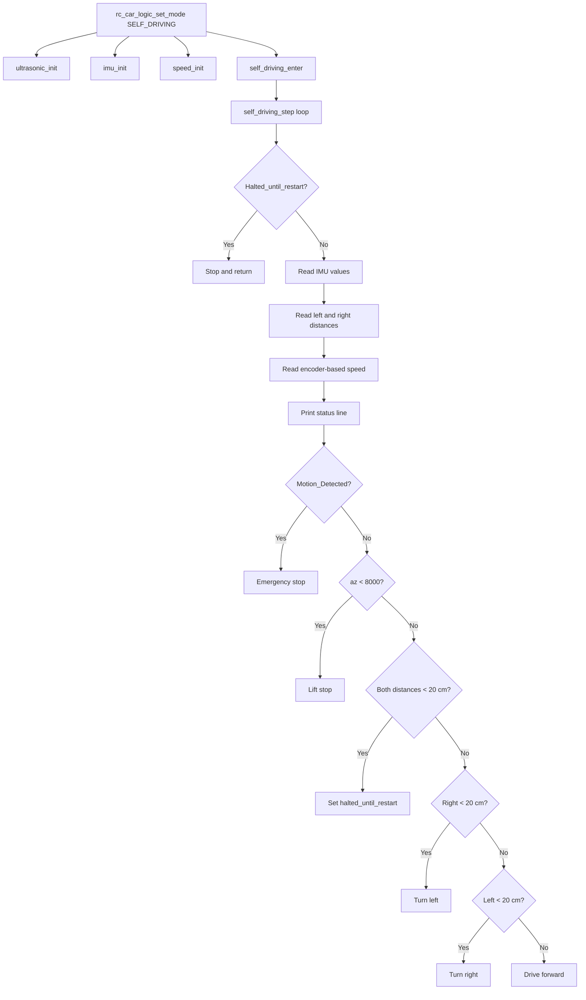

# Self-Driving Subsystem

## Overview
The self-driving subsystem provides autonomous obstacle-aware motion for the RC car using ultrasonic distance sensing, an MPU6050-based IMU, and wheel-encoder feedback. It is one of the two runtime modes of the RC car, alongside Bluetooth/manual control.

## Scope
This document explains how self-driving mode is initialized, which modules it uses, how `self_driving_step()` makes movement decisions, and which safety conditions stop the vehicle. It focuses on the implemented behavior in the firmware rather than planned autonomous features.

## Runtime position
The firmware enters self-driving mode through `rc_car_logic_set_mode(RC_CAR_MODE_SELF_DRIVING)`. On the first transition into this mode, `rc_car_logic.c` initializes the ultrasonic sensors, IMU module, and speed module, then calls `self_driving_enter()` and switches the global mode state to self-driving.

## Main modules
The self-driving subsystem is composed of four main source files.

- `self_driving.c` contains the high-level autonomous control loop and movement decisions.
- `ultrasonic.c` measures obstacle distance on the left and right sides.
- `imu.c` initializes the MPU6050, enables motion interrupts, and reads accelerometer and gyroscope data.
- `speed.c` counts wheel encoder pulses and derives distance-based speed estimates for the left and right sides.

## Entry points
The self-driving control API consists of `self_driving_enter()`, `self_driving_exit()`, `self_driving_step()`, and `self_driving_is_halted()`. `self_driving_enter()` prepares the subsystem for autonomous driving, `self_driving_exit()` stops motion and clears halt state, and `self_driving_step()` performs one full sensing and decision cycle.

## Enter and exit behavior
When self-driving mode starts, `self_driving_enter()` clears `Motion_Detected`, resets the wheel encoders, clears internal halt flags, prints a mode message, and commands the motors to move forward with a value of 65. When the mode is exited, `self_driving_exit()` stops the motors, clears halt flags, and prints an exit message.

## Control loop
`self_driving_step()` is called repeatedly from the RC car task while the global mode is self-driving. In each cycle, it first checks whether the subsystem is halted, then reads IMU values, reads left and right obstacle distances, reads the encoder-based speed values, prints a formatted status line, evaluates safety conditions, and finally decides whether to stop, turn, or continue forward.

## Obstacle handling
The obstacle logic uses two ultrasonic measurements, one on the right and one on the left. If both measured distances are below 20 cm, the vehicle stops, enters a halted state, and stays stopped until a restart condition clears that state. If only the right side is blocked, the car turns left at a command value of 80, and if only the left side is blocked, it turns right at the same command value. If neither side is below the threshold, the car continues forward at a command value of 65.

## Halt behavior
The self-driving subsystem maintains a persistent halt state using `halted_until_restart`. While this state is active, `self_driving_step()` forces the motors to stop, prints a halt message once, waits 50 ms, and returns without running the normal navigation logic. The helper `self_driving_is_halted()` exposes this state to other code.

## IMU safety behavior
The IMU layer uses an MPU6050 connected over I2C with `IMU_SDA` on `P6_1`, `IMU_SCL` on `P6_0`, and an interrupt line on `P10_5`. During initialization, the code wakes the MPU6050, checks the `WHO_AM_I` register against the expected value `0x68`, and then enables motion-detection interrupts. If a motion interrupt occurs, the ISR stops the motors and sets `Motion_Detected` to true, which causes `self_driving_step()` to perform an emergency stop on the next cycle.

## Lift detection
In addition to the interrupt-based stop, the control loop also checks the Z-axis acceleration value `az` after each IMU read. If `az` falls below 8000, the code treats this as a lift condition, stops the motors, and prints a lift-detected message. This adds a second safety mechanism against the car being picked up or tilted unexpectedly.

## Ultrasonic sensing
The ultrasonic module uses two trigger and echo pairs: right trigger `P9_0` with right echo `P9_1`, and left trigger `P9_4` with left echo `P9_5`. Each reading sends a short trigger pulse, measures how long the echo line stays high, and converts the resulting pulse duration into centimeters using the speed-of-sound calculation in the driver. If the echo wait or pulse width exceeds the timeout, the driver returns a large fallback distance value of 1000 cm.

## Speed estimation
The speed module uses wheel encoder inputs on `P9_6` and `P9_7`. Rising-edge GPIO interrupts increment `Count_EncoderRight` and `Count_EncoderLeft`, and the reported speed values are derived from those counts using `COUNTS_PER_METER` with a value of `235.0`. The functions `get_speed_right_kmh()` and `get_speed_left_kmh()` convert accumulated distance to km/h, but in the current code they do not divide by elapsed time, so they behave more like a distance-based indicator than a true instantaneous speed measurement.

## Motor interaction
The self-driving subsystem relies on the common motor layer to execute decisions. `motor_forward()` sets all four PWM outputs, `motor_stop()` clears all four duty cycles, `motor_turn_left()` powers motors A and C only, and `motor_turn_right()` powers motors B and D only. The motor pins are mapped to `P10_0` through `P10_3` in `pins.h`.

## Logging and diagnostics
`self_driving_step()` builds and prints a live status line containing right and left distance, right and left speed values, encoder counts, accelerometer values, and the `Motion_Detected` flag. This gives a useful real-time view of the autonomous state during debugging and testing.

## Supported functionality
The current implementation supports autonomous forward motion, obstacle avoidance using left and right ultrasonic sensors, emergency stop on motion interrupt, lift detection using the Z-axis acceleration threshold, encoder counting, mode entry and exit, and persistent halting when both sides are blocked. It is tightly integrated with the RC car mode manager so that the subsystem only runs when self-driving mode is active.

## Limitations
The current implementation uses a simple rule-based controller rather than path planning, mapping, or sensor fusion. There is no route memory, no target destination logic, no gradual speed control, and no evidence of PID-based steering or closed-loop velocity control in the provided code. The reported speed functions also do not compute speed over time, which limits their accuracy as physical speed measurements.

## Self-driving flow
