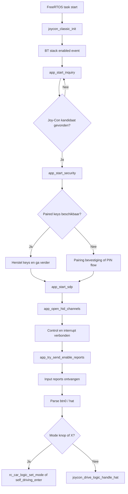

# Bluetooth in het Joy-Con Host Project

## Overzicht
Dit document legt uit hoe Bluetooth op applicatieniveau gebruikt wordt in het project, met de focus op de hostimplementatie in `joycon_classic.c`. De applicatie initialiseert de Bluetooth-host éénmalig en bedient daarna de verbindingsstatus continu vanuit de hoofdtask door elke 10 ms `joycon_classic_process()` aan te roepen.

## Bronlocatie
`joycon_classic.c` bevindt zich onder `rc_car/joycon/`. De Bluetooth debug helper `app_bt_utils.c` bevindt zich onder `common/`.

## Belangrijkste ingangspunten
De publieke interface bestaat uit `joycon_classic_init()` en `joycon_classic_process()`. `joycon_classic_init()` initialiseert het Bluetooth-platform en start de WICED-stack. `joycon_classic_process()` zorgt voor retries, security-herstarts, inquiry-planning, keepalive-gedrag en mode-switch-knopafhandeling tijdens runtime.

## Belangrijke interne functies
De belangrijkste interne functies in `joycon_classic.c` zijn `app_bt_management_callback()`, `app_start_inquiry()`, `app_start_security()`, `app_start_sdp()`, `app_open_hid_channels()`, `app_try_send_enable_reports()`, `app_send_subcommand_03()` en `app_l2cap_data_ind_cb()`. Samen dekken deze het volledige Bluetooth-traject van stack-events en device-detectie tot pairing, kanaalopbouw, report-modusconfiguratie en binnenkomende inputverwerking.

## Opstartgedrag
De FreeRTOS-task initialiseert de motorlaag en status-LED voordat `joycon_classic_init()` wordt aangeroepen. Nadat de Bluetooth-stack `BTM_ENABLED_EVT` rapporteert, markeert de management-callback Bluetooth als ingeschakeld en plant device-inquiry in, waarmee de zoektocht naar een Joy-Con-kandidaat begint.

## Discovery en identificatie
De implementatie filtert inquiry-resultaten via `app_is_joycon_candidate()`, `app_name_looks_like_joycon()` en `app_remote_name_looks_like_joycon()`. De host maakt niet blindelings verbinding met elk willekeurig Bluetooth-apparaat in de buurt — hij controleert zowel device-klasse (peripheral CoD + HID UUID) als naam-gerelateerde informatie voordat hij verdergaat.

## Pairing en reconnectie
Security-afhandeling is gecentraliseerd in `app_bt_management_callback()` en `app_start_security()`. De code bewaart en herstelt BR/EDR-linkkeys en local identity keys, bevestigt user-confirmation requests automatisch en antwoordt op legacy PIN-requests met `0000`. Dit ondersteunt reconnectie met een eerder gekoppelde controller zonder de volledige pairing-reeks te herhalen.

## HID-kanaalopbouw
Na succesvolle discovery en security voert de code SDP uit en opent vervolgens twee L2CAP-kanalen via `app_open_hid_channels()`:
- HID control-kanaal op PSM `0x0011`
- HID interrupt-kanaal op PSM `0x0013`

## Inputactivatie
Zodra beide kanalen verbonden zijn, roept `app_try_send_enable_reports()` de functie `app_send_subcommand_03()` aan om subcommand `0x03` met waarde `0x30` over het control-kanaal te sturen, waarmee de standaard full input report-modus wordt geactiveerd.

## Inputverwerking en modeknoppen
Wanneer geldige input binnenkomt, parseert `app_l2cap_data_ind_cb()` de button-bytes en hat-richting. Drie knopacties worden afgehandeld in `btn0`:

| Masker | Actie |
|---|---|
| `0x08 ( Y )` | Schakel naar self-driving mode |
| `0x04 ( B )` | Schakel naar Bluetooth/handmatige mode |
| `0x02 ( X )` | Knop om self-driving te herstarten als de auto gestopt is |

De X-knop herstart alleen wanneer `rc_car_logic_is_self_driving_active()` EN `self_driving_is_halted()` beide waar zijn. Hat-richtingswijzigingen worden doorgestuurd naar `joycon_drive_logic_handle_hat()` alleen wanneer self-driving niet actief is. Alle knopdrukken worden edge-gedetecteerd om precies één keer per druk te activeren.

## LED-feedback
De status-LED op P13_7 knippert terwijl de controller verbinding maakt en gaat continu branden wanneer het eerste geldige inputrapport binnenkomt, wat duidelijke visuele feedback geeft van de verbindingsstatus.

## Keepalive
Terwijl de input-report-modus actief is, stuurt `joycon_classic_process()` elke 100 ticks (~1 s) opnieuw subcommand `0x03` om de actieve sessie te behouden.

## Verbreken en herverbinden
Bij L2CAP-verbreking worden kanaal-ID's gewist, wordt de rijlogica gereset via `joycon_drive_logic_reset()`, keert de LED terug naar knipperen en wordt `app_start_security()` opnieuw aangeroepen als het Joy-Con BD-adres nog bekend is.

## Niet ondersteund
Rumble-effecten (alleen placeholder-bytes), IMU-subcommands, SPI-geheugentoegang, batterijrapportage, player-LED's, NFC, IR-functies en aansturing via analoge sticks.

## Discovery- en pairing-flow

