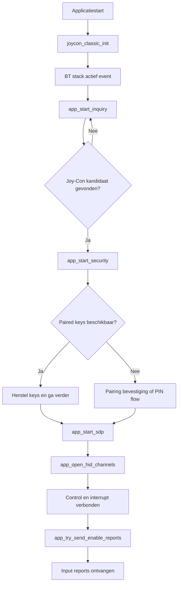

# Bluetooth in het Joy-Con Host Project

## Overzicht
Dit document legt uit hoe Bluetooth op applicatieniveau gebruikt wordt in het project, met de focus op de hostimplementatie in `joycon_classic.c`. De applicatie initialiseert de Bluetooth-host éénmalig en bedient daarna de verbindingsstatus continu vanuit de hoofdtask door elke 10 ms `joycon_classic_process()` aan te roepen.

## Publieke ingangspunten
De publieke interface van de module is bewust klein en bestaat uit `joycon_classic_init()` en `joycon_classic_process()`. `joycon_classic_init()` initialiseert het Bluetooth-platform en start de WICED-stack, terwijl `joycon_classic_process()` retries, security-herstarts, inquiry-planning en periodiek keepalive-gedrag tijdens runtime afhandelt.

## Belangrijke interne functies
De belangrijkste interne functies in `joycon_classic.c` zijn `app_bt_management_callback()`, `app_start_inquiry()`, `app_start_security()`, `app_start_sdp()`, `app_open_hid_channels()`, `app_try_send_enable_reports()`, `app_send_subcommand_03()` en `app_l2cap_data_ind_cb()`. Samen dekken deze functies het volledige Bluetooth-pad van stack-events en apparaatdetectie tot pairing, kanaalachitectuur, report-modusconfiguratie en binnenkomende inputverwerking.

## Opstartgedrag
Tijdens het opstarten initialiseert de applicatie het board, UART-logging, de motormodule en de LED-module voordat `joycon_classic_init()` wordt aangeroepen. Nadat de Bluetooth-stack `BTM_ENABLED_EVT` meldt, markeert de management-callback Bluetooth als actief en plant het apparaatinquiry in, waarmee de zoektocht naar een Joy-Con kandidaat begint.

## Discovery en identificatie
De implementatie bevat expliciete Joy-Con kandidaatcontroles via `app_is_joycon_candidate()`, `app_name_looks_like_joycon()` en `app_remote_name_looks_like_joycon()`. Dit betekent dat de discovery-logica niet blind verbinding maakt met elk nabijgelegen Bluetooth-apparaat, maar apparaten filtert op klasse en naamgerelateerde informatie voordat verder gegaan wordt.

## Pairing en reconnectie
De security-afhandeling is gecentraliseerd in `app_bt_management_callback()` en `app_start_security()`. De code bewaart local identity keys en paired BR/EDR link keys, herstelt opgeslagen keys wanneer mogelijk, accepteert user confirmation requests en antwoordt op legacy PIN-requests met `0000`, zodat reconnectie met een eerder gekoppelde controller mogelijk is zonder telkens de volledige pairingflow opnieuw uit te voeren.

## HID-kanaalachitectuur
Na succesvolle discovery en security gaat de code verder met SDP en opent daarna twee L2CAP-kanalen via `app_open_hid_channels()`. Dit zijn het HID control channel op PSM `0x0011` en het HID interrupt channel op PSM `0x0013`, die samen het transport vormen voor de Joy-Con report uitwisseling.

## Inputactivatie
Zodra beide kanalen verbonden zijn, roept `app_try_send_enable_reports()` de functie `app_send_subcommand_03()` aan om subcommand `0x03` met waarde `0x30` over het control channel te sturen. Dat verzoek activeert de standaard full input report mode die later door `app_l2cap_data_ind_cb()` gebruikt wordt om buttondata, hat-richting en analoge stickwaarden uit binnenkomende reports te verwerken.

## Interactie met de rest van het project
Wanneer de eerste geldige inputwijzigingen binnenkomen, markeert de Bluetooth-module de LED als input-ready door `joycon_status_led_set_input_ready()` aan te roepen. Hat-richtingswijzigingen worden doorgestuurd naar `joycon_drive_logic_handle_hat()`, die bepaalde richtingsinputs omzet naar motorcommando's zoals vooruit, links, rechts of stoppen.

## Ondersteunde functionaliteit
De huidige implementatie ondersteunt Joy-Con discovery, pairing of key restoration, HID control- en interruptkanaalopbouw, activatie van de standaard full input report mode, verwerking van button- en stickdata, hat-richting gebaseerde rijbesturing en reconnectiepogingen na verbroken verbindingen. Het biedt ook een verbindingsstatus-led, UART-debuglogging en een software keepalive die het input-modus subcommand opnieuw verstuurt zolang de sessie actief is.

## Niet ondersteund of niet aanwezig
De huidige code toont geen ondersteuning voor het versturen van rumble-effecten, het uitlezen van IMU-sensordata, SPI-geheugentoegang, batterijrapportering, NFC- of IR-functies, of geavanceerde Joy-Con configuratiecommando's buiten het input-modusverzoek. Het verzonden subcommandpakket bevat rumble-plaatshouders, maar deze zijn gevuld met nullen in plaats van dynamisch aangestuurde trillingsdata.

## Discovery- en pairingflow

Deze flow komt overeen met de structuur van de implementatie, waarbij inquiry, security, SDP, L2CAP-opbouw en inputactivatie in volgorde worden uitgevoerd met retries wanneer nodig.