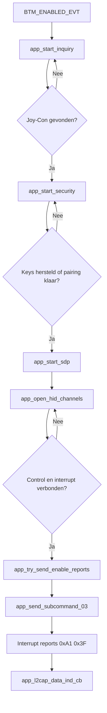

# Bluetooth Protocol van de Joy-Con Host

## Overzicht
Dit document beschrijft de protocolflow die geïmplementeerd is in `joycon_classic.c`, met nadruk op de sleutelfuncties die de verbinding van discovery naar actieve inputverwerking brengen. De implementatie gebruikt een BR/EDR HID-stijl verbinding opgebouwd via inquiry, security, SDP en twee L2CAP-kanalen voor control- en interruptverkeer.

## Sleutelfuncties in het protocolpad
Het kernprotocolpad is verdeeld over `joycon_classic_init()`, `joycon_classic_process()`, `app_bt_management_callback()`, `app_start_inquiry()`, `app_start_security()`, `app_start_sdp()`, `app_open_hid_channels()`, `app_try_send_enable_reports()`, `app_send_subcommand_03()` en `app_l2cap_data_ind_cb()`. Deze functies zijn het nuttigst om in documentatie te benoemen omdat ze direct overeenkomen met de grote protocolfasen die een lezer wil begrijpen.

## Protocolfasen
De door de code geïmplementeerde protocolsequentie is: stackinitialisatie, Joy-Con kandidaatdetectie, pairing of key restoration, SDP-servicedetectie, L2CAP HID-kanaalopbouw, report-modusactivatie en continue inputreportverwerking. `joycon_classic_process()` houdt die sequentie over tijd in stand door vertraagde retries voor inquiry en security af te handelen en periodiek keepalive-verkeer te versturen zodra de sessie actief is.

## Discoveryfase
Discovery begint nadat `BTM_ENABLED_EVT` ontvangen wordt in `app_bt_management_callback()`. Kandidaatevaluatie wordt ondersteund door `app_is_joycon_candidate()`, `app_name_looks_like_joycon()` en `app_remote_name_looks_like_joycon()`, wat aangeeft dat de host zowel klasse-informatie als Joy-Con-gerelateerde naaaminformatie controleert voordat een doeltoestel geselecteerd wordt.

## Securityfase
De securityfase wordt afgehandeld via Bluetooth management-events en `app_start_security()`. De code bewaart en herstelt BR/EDR link keys, bewaart local identity keys, bevestigt user-confirmation requests en antwoordt op legacy PIN-requests met `0000`, zodat zowel eerste pairing als latere reconnectie door de implementatie ondersteund worden.

## SDP-fase
De code reserveert een SDP discovery database van 1024 bytes en definieert `app_bt_sdp_complete_cb()` als callback voor SDP-voltooiing. In protocoltermen is SDP de stap die pairing en transport-setup verbindt door de host voor te bereiden om de juiste HID-communicatiekanalen op de externe controller te openen.

## L2CAP-transportfase
De L2CAP-transportlaag wordt geopend via `app_open_hid_channels()` en bewaakt via `app_l2cap_connected_cb()`, `app_l2cap_disconnect_ind_cb()` en `app_l2cap_disconnect_cfm_cb()`. De implementatie gebruikt twee HID-gerelateerde PSM-waarden, `0x0011` voor het control pad en `0x0013` voor het interrupt pad, en de projectconfiguratie reserveert precies twee applicatie L2CAP-kanalen voor dit ontwerp.

## Report-activatiefase
Wanneer beide kanalen actief zijn, roept `app_try_send_enable_reports()` de functie `app_send_subcommand_03()` aan. Die functie stuurt een pakket met beginbytes `0xA2`, report ID `0x01` en subcommand `0x03` met waarde `0x30`, waarmee de standaard full input report mode wordt aangevraagd die door de rest van de hostlogica gebruikt wordt.

## Inputreportfase
`app_l2cap_data_ind_cb()` verwerkt interrupt-channel pakketten die beginnen met `0xA1` en report ID `0x3F`. Voor die frames haalt de code button-bytes, hat-richting en analoge stickwaarden uit vaste offsets, werkt de gecachte inputstatus bij, markeert de LED als ready en stuurt hat-wijzigingen door naar de rijlogicalaag.

## Ondersteund protocolgedrag
Het geïmplementeerde protocolgedrag omvat discovery, pairing of key restore, HID control- en interrupttransport-setup, subcommand-gebaseerde report-modusactivatie, herhaalde keepalive-transmissie, disconnect-opruiming en reconnectiepogingen. Op applicatieniveau wordt de ontvangen hat-input gebruikt voor motorbesturing en geeft de status-led de verbindingstoestand aan.

## Niet ondersteund of niet geïmplementeerd gedrag
De huidige protocolimplementatie toont geen ondersteuning voor rijkere Joy-Con subcommando's zoals motion sensor configuratie, SPI lees- of schrijfoperaties, batterijopvragen, speler-leds, NFC- of IR-functies, of actieve rumble-besturing. Hoewel het uitgaande reportformaat rumble-bytes reserveert, stuurt de code nulgevulde plaatshouders in plaats van echte trillingcommando's.

## Flowchart

Dit diagram geeft een compact overzicht van het protocolpad dat aanwezig is in de implementatie en benadrukt de sleutelfunctienamen die een lezer kan terugvinden in `joycon_classic.c`.