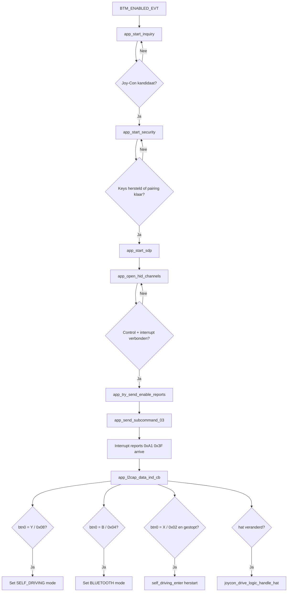

# Bluetooth Protocol van de Joy-Con Host

## Overzicht
Dit document beschrijft de protocolflow die geïmplementeerd is in `joycon_classic.c`, met nadruk op de sleutelfuncties die de verbinding van discovery naar actieve inputverwerking brengen. De implementatie gebruikt een BR/EDR HID-stijl verbinding opgebouwd via inquiry, security, SDP en twee L2CAP-kanalen voor control- en interruptverkeer.

## Bronlocatie
`joycon_classic.c` bevindt zich onder `rc_car/joycon/`.

## Sleutelfuncties in het protocolpad
Het kernprotocolpad is verdeeld over `joycon_classic_init()`, `joycon_classic_process()`, `app_bt_management_callback()`, `app_start_inquiry()`, `app_start_security()`, `app_start_sdp()`, `app_open_hid_channels()`, `app_try_send_enable_reports()`, `app_send_subcommand_03()` en `app_l2cap_data_ind_cb()`. Deze functies komen direct overeen met de belangrijkste protocolfasen.

## Protocolfasen
De protocolvolgorde is: stackinitialisatie → Joy-Con-kandidaat-detectie → pairing of key-herstel → SDP-servicedetectie → L2CAP-HID-kanaalopbouw → report-modusactivering → continue inputreport-verwerking. `joycon_classic_process()` houdt de sequentie in stand door vertraagde retries voor inquiry en security af te handelen en door periodiek keepalive-verkeer te sturen zodra de sessie actief is.

## Fase 1 — Stackinitialisatie
`joycon_classic_init()` initialiseert het WICED BT-platform. Wanneer de stack `BTM_ENABLED_EVT` rapporteert in `app_bt_management_callback()`, wordt de `bt_enabled`-vlag gezet en `app_start_inquiry()` ingepland. Het apparaat presenteert zichzelf als `PSoC6-JoyConHost`.

## Fase 2 — Discovery
`app_start_inquiry()` start een BR/EDR general inquiry. Elk resultaat wordt geëvalueerd door `app_is_joycon_candidate()`, dat de CoD major class (peripheral) en HID UUID in EIR-data controleert. Bij een match wordt de EIR-naam gecontroleerd door `app_name_looks_like_joycon()`. Staat de naam niet in de EIR, dan wordt een asynchrone remote-name-aanvraag gedaan en geëvalueerd in `app_bt_remote_name_cb()`. Naamvergelijking is hoofdletterongevoelig.

## Fase 3 — Security
`app_start_security()` roept `wiced_bt_dev_sec_bond()` aan. De management-callback handelt het volgende af:

| Event | Afhandeling |
|---|---|
| `BTM_PAIRED_DEVICE_LINK_KEYS_UPDATE_EVT` | Linkkeys opslaan |
| `BTM_PAIRED_DEVICE_LINK_KEYS_REQUEST_EVT` | Opgeslagen keys herstellen |
| `BTM_LOCAL_IDENTITY_KEYS_UPDATE_EVT` | Local identity keys opslaan |
| `BTM_LOCAL_IDENTITY_KEYS_REQUEST_EVT` | Local identity keys herstellen |
| `BTM_USER_CONFIRMATION_REQUEST_EVT` | Auto-bevestigen |
| `BTM_PIN_REQUEST_EVT` | Antwoorden met PIN `"0000"` |
| `BTM_PAIRING_COMPLETE_EVT` | Markeren als gepaired, doorgaan naar SDP |

Bij herverbinding met opgeslagen keys wordt de volledige pairing overgeslagen en gaat men direct door naar SDP.

## Fase 4 — SDP
`app_start_sdp()` wijst een SDP-discoverydatabase van 1024 bytes toe en start servicediscovery. `app_bt_sdp_complete_cb()` wordt aangeroepen bij voltooiing en activeert `app_open_hid_channels()`.

## Fase 5 — L2CAP-transport
`app_open_hid_channels()` opent twee verbindingen:

| Kanaal | PSM | Doel |
|---|---|---|
| HID Control | `0x0011` | Uitgaande subcommands |
| HID Interrupt | `0x0013` | Binnenkomende input reports |

MTU is 672 bytes. Beide kanalen moeten bevestigd worden via `app_l2cap_connected_cb()` voordat verdergegaan wordt.

## Fase 6 — Reportactivering
Zodra beide kanalen actief zijn, vuurt `app_try_send_enable_reports()` eenmalig en roept `app_send_subcommand_03()` aan:

```
Byte  Waarde  Betekenis
0     0xA2    BT HID output report prefix
1     0x01    Output report ID
2     0x00    Packet counter
3–6   0x00    Rumble links (ongebruikt)
7–10  0x00    Rumble rechts (ongebruikt)
11    0x03    Subcommand: set input report mode
12    0x30    Standard full input report mode
```

## Fase 7 — Inputreport-verwerking
`app_l2cap_data_ind_cb()` verwerkt pakketten die beginnen met `0xA1 0x3F` op het interruptkanaal:

| Offset | Veld | Actie |
|---|---|---|
| `[2]` | `btn0` | Mode-switch + X-knop herstart |
| `[3]` | `btn1` | Button byte 1 |
| `[4] & 0x0F` | `hat` | → `joycon_drive_logic_handle_hat()` |
| `[5]`, `[7]` | `lx`, `ly` | Linker stick (gelogd) |
| `[9]`, `[11]` | `rx`, `ry` | Rechter stick (gelogd) |

Knopafhandeling in `btn0`:

| Masker | Actie |
|---|---|
| `0x08 ( Y )` | `rc_car_logic_set_mode(RC_CAR_MODE_SELF_DRIVING)` |
| `0x04 ( B )` | `rc_car_logic_set_mode(RC_CAR_MODE_BLUETOOTH)` |
| `0x02 ( X )` | `self_driving_enter()` indien gestopt (X-knop herstart) |

Alle knopacties zijn edge-gedetecteerd (XOR met vorige `btn0`) zodat elke druk precies één keer activeert.

## Runtime — keepalive en retries
`joycon_classic_process()` wordt elke ~10 ms aangeroepen en handelt inquiry-retry-ticks, security-retry-ticks en het opnieuw versturen van subcommand `0x03` elke 100 ticks af zolang de sessie actief is.

## Verbreken en herverbinden
Bij `app_l2cap_disconnect_ind_cb()` of `app_l2cap_disconnect_cfm_cb()` worden CIDs gewist, stopt `joycon_drive_logic_reset()` de motoren, keert de LED terug naar knipperen en wordt `app_start_security()` opnieuw aangeroepen als het Joy-Con-adres nog bekend is.

## Protocolflowchart


## Niet geïmplementeerd
Rumble (alleen placeholder), IMU-subcommands, SPI-leesacties, batterijquery's, player-LED's, NFC, IR-functies.
