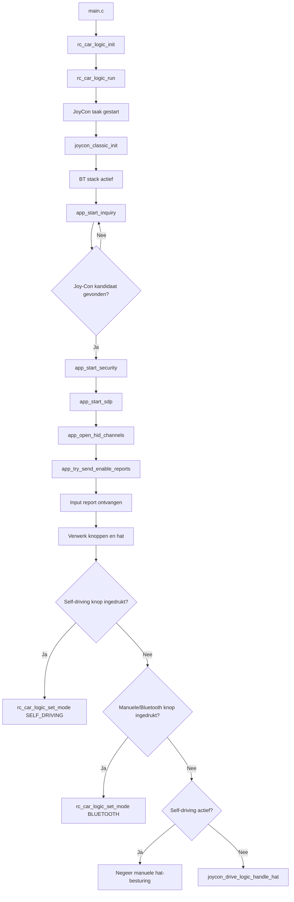

# Joy-Con Subsystem

## Overzicht
Het Joy-Con subsysteem zorgt voor Bluetooth-gebaseerde manuele besturing van de RC-auto en fungeert ook als gebruikersinterface om te wisselen tussen manuele bediening en self-driving mode. Het combineert Bluetooth discovery en pairing, HID-communicatie, inputverwerking, statusindicatie en rijcommando's in één geïntegreerd subsysteem.

## Doel
Dit document beschrijft het volledige Joy-Con pad in de firmware, inclusief opstart, Bluetooth-communicatie, mode switching, LED-feedback en interactie met de motorlaag en de RC car logic. De focus ligt op hoe de huidige implementatie in de code werkt.

## Plaats in runtime
De firmware start in `main.c`, initialiseert het board en UART-logging, en geeft daarna de controle door aan `rc_car_logic_init()` en `rc_car_logic_run()` voor de ondersteunde RC-car boardconfiguratie. Binnen `rc_car_logic_run()` wordt een FreeRTOS-task aangemaakt die de motoren, de Joy-Con status-led en de Joy-Con Bluetooth-host initialiseert voordat de hoofdloop start.

## Belangrijkste modules
Het Joy-Con subsysteem bestaat uit vijf hoofdmodules.

- `joycon_classic.c` implementeert het opstarten van de Bluetooth-stack, Joy-Con discovery, pairing, SDP, L2CAP channel setup, reportactivatie, inputverwerking en de knoppenlogica voor mode switching.
- `app_bt_utils.c` bevat hulpfuncties voor leesbare Bluetooth-logs, zoals eventnamen, advertising modes, disconnect-redenen en statusnamen.
- `joycon_drive_logic.c` vertaalt bepaalde Joy-Con hat-richtingen naar motoracties voor manueel rijden.
- `joycon_status_led.c` beheert één status-led die knippert tijdens de verbinding en continu brandt zodra input actief is.
- `rc_car_logic.c` koppelt het Joy-Con subsysteem aan de rest van de applicatie en bepaalt of de auto in Bluetooth/manuele mode of self-driving mode werkt.

## Publieke ingangspunten
De publieke API van de Bluetooth-hostzijde is bewust klein en bestaat uit `joycon_classic_init()` en `joycon_classic_process()`. `joycon_classic_init()` initialiseert het Bluetooth-platform en start de WICED-stack, terwijl `joycon_classic_process()` retries, vertraagde acties en keepalive-gedrag tijdens runtime afhandelt. Op applicatieniveau maken `rc_car_logic_set_mode()`, `rc_car_logic_get_mode()` en `rc_car_logic_is_self_driving_active()` het mogelijk om de huidige mode te wijzigen of op te vragen.

## Opstartvolgorde
De runtime-sequentie begint met boardinitialisatie en UART-setup in `main.c`. Daarna initialiseert de RC-car task de motorlaag, stopt de motoren, initialiseert de led, zet de led in connecting mode en start de Joy-Con Bluetooth-host via `joycon_classic_init()`. Vervolgens roept de task continu `joycon_classic_process()` en `joycon_status_led_process()` aan, en alleen `self_driving_step()` wanneer self-driving mode actief is.

## Bluetooth-hostgedrag
De Bluetooth-hostlogica is geïmplementeerd in `joycon_classic.c` met de WICED Bluetooth-stack en de bijbehorende management-, SDP- en L2CAP-API's. De geconfigureerde device name is `PSoC6-JoyConHost`, en de implementatie is opgebouwd als een host die een Joy-Con zoekt, de verbinding beveiligt, HID-kanalen opent en daarna controllerreports verwerkt.

## Belangrijke functies in `joycon_classic.c`
De belangrijkste interne functies zijn `app_bt_management_callback()`, `app_start_inquiry()`, `app_start_security()`, `app_start_sdp()`, `app_open_hid_channels()`, `app_try_send_enable_reports()`, `app_send_subcommand_03()` en `app_l2cap_data_ind_cb()`. Samen implementeren deze functies het volledige controllerpad van Bluetooth-opstart tot actieve inputverwerking.

## Discovery en selectie
Nadat de Bluetooth-stack `BTM_ENABLED_EVT` meldt, markeert de management-callback Bluetooth als klaar en wordt inquiry ingepland. De selectie van kandidaten gebeurt via hulplogica zoals `app_is_joycon_candidate()`, `app_name_looks_like_joycon()` en `app_remote_name_looks_like_joycon()`, wat aangeeft dat de code zowel class-gerelateerde als naam-gerelateerde informatie controleert.

## Pairing en reconnectie
Security-afhandeling gebeurt via management-events en expliciete security-opstartlogica. De implementatie bewaart local identity keys en paired BR/EDR link keys, herstelt keys voor bekende apparaten, accepteert user-confirmation requests en antwoordt op legacy PIN-requests met `0000`, zodat reconnectie mogelijk is zonder telkens de volledige pairingflow opnieuw uit te voeren.

## SDP en L2CAP-kanalen
De code definieert twee HID-gerelateerde PSM-waarden: `0x0011` voor het control channel en `0x0013` voor het interrupt channel. Er wordt een SDP discovery database van 1024 bytes voorzien voordat de L2CAP HID-kanalen worden geopend, wat overeenkomt met de verwachte volgorde van service discovery gevolgd door transport setup.

## Activatie van inputreports
Zodra beide L2CAP-kanalen verbonden zijn, roept `app_try_send_enable_reports()` de functie `app_send_subcommand_03()` aan. Die functie stuurt een control-channel pakket met beginbytes `0xA2`, report ID `0x01` en subcommand `0x03` met waarde `0x30`, waarmee de standaard full input report mode wordt geactiveerd.

## Inputverwerking
Binnenkomende interrupt-channel data wordt verwerkt in `app_l2cap_data_ind_cb()`. Wanneer de payload begint met `0xA1` en report ID `0x3F`, haalt de code button-bytes, hat-richting en analoge stickwaarden uit vaste offsets in het pakket en werkt de interne controllerstatus bij. De module reageert alleen wanneer de toestand verandert, zodat identieke inputframes niet telkens opnieuw verwerkt worden.

## Manuele rijlogica
Manuele beweging wordt uitgevoerd via `joycon_drive_logic_handle_hat()` wanneer self-driving mode niet actief is. In de huidige implementatie betekent hat-waarde `0x00` vooruitrijden, zorgen `0x06` en `0x07` voor rechts draaien, zorgen `0x02` en `0x01` voor links draaien, en stoppen alle andere waarden de auto. De manuele rijlaag gebruikt hierbij een vaste PWM-waarde van 100.

## Mode switching
Het Joy-Con subsysteem fungeert ook als gebruikersinterface om van werkingsmode te wisselen. In `joycon_classic.c` worden buttonwijzigingen gecontroleerd tegen `JOYCON_BTN_SELF_MASK` met waarde `0x08` en `JOYCON_BTN_MANUAL_MASK` met waarde `0x04`. Een druk op de self-driving knop roept `rc_car_logic_set_mode(RC_CAR_MODE_SELF_DRIVING)` aan, terwijl een druk op de manual/Bluetooth knop `rc_car_logic_set_mode(RC_CAR_MODE_BLUETOOTH)` aanroept.

## Led-gedrag
De status-led is verbonden met pin `P13_7` en is actief-laag geconfigureerd. Terwijl de controller verbinding maakt, knippert de led door elke 25 softwareticks te toggelen in `joycon_status_led_process()`. Zodra geldige input ontvangen wordt, zet `joycon_status_led_set_input_ready()` de led in een continu aan-toestand.

## Logging helpers
`app_bt_utils.c` maakt runtime-logs leesbaarder door numerieke Bluetooth-waarden om te zetten naar begrijpelijke tekst. De module bevat hulpfuncties voor het afdrukken van Bluetooth-adressen en voor het benoemen van management-events, advertising modes, GATT disconnect-redenen en GATT-statuscodes.

## Interactie met de RC-car laag
`rc_car_logic.c` initialiseert de Joy-Con-gerelateerde modules en bepaalt of manuele of self-driving logica in de hoofdloop moet draaien. Wanneer het systeem voor het eerst self-driving mode binnengaat, initialiseert `rc_car_logic_set_mode()` de ultrasonic-, IMU- en speedmodules en roept daarna `self_driving_enter()` aan. Wanneer het systeem terugkeert naar Bluetooth/manuele mode, roept `rc_car_logic_set_mode()` indien nodig `self_driving_exit()` aan, stopt het de motoren en print het de modewijziging naar de console.

## Hardware-afhankelijkheden
Het Joy-Con subsysteem hangt af van de motorlaag, de RC car logic-laag en de board-specifieke Bluetooth-configuratie. Het gebruikt ook indirect de PWM-motoruitgangen via de manuele rijlogica en gebruikt de led-uitgang op `P13_7` voor statusindicatie.

## Ondersteunde functionaliteit
De huidige implementatie ondersteunt Joy-Con discovery, kandidaatselectie, pairing of key restoration, SDP, HID control- en interruptkanaalopbouw, activatie van inputreports, inputverwerking, manuele rijcommando's via de hat-switch, led-feedback voor de verbindingsstatus en mode switching tussen Bluetooth/manuele en self-driving werking. Daarnaast ondersteunt het UART-gebaseerde debuglogging met leesbare Bluetooth-eventnamen via de helpermodule.

## Beperkingen
De huidige Joy-Con implementatie focust op verbinding opzetten, input verwerken, manueel rijden en mode switching. Extra Joy-Con functies zoals actieve rumble, batterijrapportering, NFC- of IR-ondersteuning en analoge stickbesturing zijn momenteel niet geïmplementeerd. Manueel rijden is voorlopig beperkt tot input via de hat-richting.

## Discovery- en controlflow
