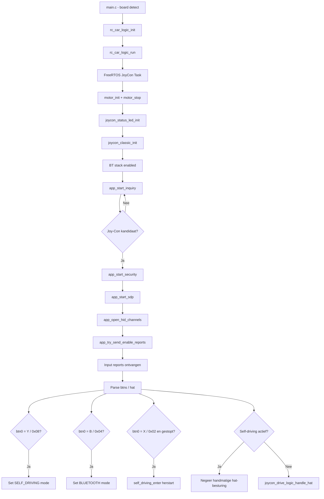

# Joy-Con Subsystem

## Overzicht
Het Joy-Con subsysteem zorgt voor Bluetooth-gebaseerde handmatige besturing van de RC-auto en fungeert als gebruikersinterface om te wisselen tussen handmatig rijden en self-driving mode. Het combineert Bluetooth-discovery en pairing, HID-communicatie, inputdecodering, statusindicatie en rijcommando's in één geïntegreerd subsysteem.

## Doel
Dit document beschrijft het volledige Joy-Con-traject in de firmware, inclusief opstarten, Bluetooth-communicatie, mode-switching, X-knop herstart, LED-feedback en interactie met de motor- en RC-car-besturingslagen.

## Bronlocatie
De Joy-Con-subsysteembestanden bevinden zich onder `rc_car/joycon/`:

```
rc_car/joycon/
    joycon_classic.c / .h     — Bluetooth stack, HID protocol, input parsing, mode switching
    joycon_drive_logic.c / .h — Hat input → motor commands
    joycon_status_led.c / .h  — Verbindingsstatus LED
```

## Runtime-positie
De firmware start in `main.c`, dat het doelboard detecteert via preprocessor-defines. Op de CY8CKIT-062-WIFI-BT Pioneer Kit wordt `rc_car_logic_init()` en `rc_car_logic_run()` aangeroepen. De proto-kit variant (`CY8CPROTO-062-4343W`) wordt gedetecteerd maar is nog niet geïmplementeerd. Binnen `rc_car_logic_run()` wordt een FreeRTOS-task aangemaakt die motoren, de status-LED en de Joy-Con Bluetooth-host initialiseert voordat de hoofdloop begint.

## Hoofdmodules

| Bestand | Verantwoordelijkheid |
|---|---|
| `joycon_classic.c` | Volledige Bluetooth-host: discovery, pairing, SDP, L2CAP, inputdecodering, mode-switch-knoppen |
| `app_bt_utils.c` | Leesbare Bluetooth-loghelpers (event-namen, disconnect-redenen, statuscodes) |
| `joycon_drive_logic.c` | Vertaalt Joy-Con hat-richting naar `motor_*`-aanroepen voor handmatig rijden |
| `joycon_status_led.c` | Knippert LED tijdens verbinding, continu aan wanneer input actief is |
| `rc_car_logic.c` | Beheert de operationele modus, maakt FreeRTOS-task aan, handelt modusovergangen af |

## Publieke ingangspunten
De publieke API van de Bluetooth-host bestaat uit `joycon_classic_init()` en `joycon_classic_process()`. Op applicatieniveau stellen `rc_car_logic_set_mode()`, `rc_car_logic_get_mode()` en `rc_car_logic_is_self_driving_active()` het bredere systeem in staat te schakelen en de huidige werkingsmodus op te vragen.

## FreeRTOS-taskloop
De hoofdtaakloop draait continu:

```c
for (;;) {
    joycon_classic_process();       // BT input, retries, keepalive, mode buttons
    joycon_status_led_process();    // LED knipperen of vasthouden

    if (mode == RC_CAR_MODE_SELF_DRIVING)
        self_driving_step();        // 50 ms sensor-beslis-handel cyclus
    else
        vTaskDelay(10 ms);          // yield in BT mode
}
```

## Bluetooth-hostgedrag
De Bluetooth-host gebruikt de WICED BR/EDR-stack. De geconfigureerde apparaatnaam is `PSoC6-JoyConHost`. De host zoekt naar een Joy-Con-kandidaat, beveiligt de verbinding, opent HID-kanalen, activeert inputreports en verwerkt vervolgens continu controller-input.

## Belangrijke interne functies

| Functie | Rol |
|---|---|
| `app_bt_management_callback()` | Centrale BT-event-handler |
| `app_start_inquiry()` | Start BR/EDR device inquiry |
| `app_is_joycon_candidate()` | Filtert op device-klasse en HID UUID |
| `app_name_looks_like_joycon()` | Valideert EIR-naamvelden |
| `app_start_security()` | Initieert pairing of key-herstel |
| `app_start_sdp()` | SDP-servicediscovery vóór kanaalopbouw |
| `app_open_hid_channels()` | Opent L2CAP control (0x0011) en interrupt (0x0013) |
| `app_try_send_enable_reports()` | Activeert report-modus zodra beide kanalen actief zijn |
| `app_send_subcommand_03()` | Stuurt subcommand 0x03 / waarde 0x30 voor full input report mode |
| `app_l2cap_data_ind_cb()` | Parseert binnenkomende HID-reports, verwerkt input en knoppen |

## Inputparsing
`app_l2cap_data_ind_cb()` verwerkt interrupt-kanaalpakketten die beginnen met `0xA1 0x3F`. Geparseerde velden:

| Byte | Veld | Gebruik |
|---|---|---|
| `[2]` | `btn0` | Mode-switch en herstartknoppen |
| `[3]` | `btn1` | Button byte 1 |
| `[4] & 0x0F` | `hat` | D-pad richting → rijlogica |
| `[5]`,`[7]` | `lx`, `ly` | Linker stick |
| `[9]`,`[11]` | `rx`, `ry` | Rechter stick |

## Mode-switch-knoppen

| Knop | `btn0` masker | Actie |
|---|---|---|
| Self-driving knop | `0x08` | `rc_car_logic_set_mode(RC_CAR_MODE_SELF_DRIVING)` |
| Handmatige/BT knop | `0x04` | `rc_car_logic_set_mode(RC_CAR_MODE_BLUETOOTH)` |
| **X-knop** | **`0x02`** | **`self_driving_enter()` — herstart self-driving indien gestopt** |

Knopdrukken zijn edge-gedetecteerd (XOR met vorige `btn0`) zodat elke druk precies één keer activeert. De X-knop vuurt alleen wanneer `rc_car_logic_is_self_driving_active()` EN `self_driving_is_halted()` beide waar zijn — hij kan niet per ongeluk van modus wisselen tijdens normaal rijden.

## Handmatig rijden — hat-mapping

| Hat-waarde | Richting | Motorcommando |
|---|---|---|
| `0x00` | Omhoog | `motor_forward(100)` |
| `0x01`, `0x02` | Omhoog-rechts / Rechts | `motor_turn_left(100)` |
| `0x06`, `0x07` | Omlaag-links / Links | `motor_turn_right(100)` |
| Andere | Neutraal | `motor_stop()` |

Hat-input wordt alleen doorgestuurd naar de rijlogica wanneer self-driving mode niet actief is.

## LED-gedrag

| Toestand | LED |
|---|---|
| Verbinding maken / zoeken | Knippert elke 25 ticks |
| Inputreports ontvangen | Continu aan |

LED-pin: P13_7 (actief-laag). Geïnitialiseerd in `joycon_status_led_init()`.

## Pairing en herverbinding
De implementatie bewaart en herstelt `wiced_bt_device_link_keys_t` en `wiced_bt_local_identity_keys_t`. Bevestigt user-confirmation requests automatisch en antwoordt op legacy PIN-requests met `"0000"`. Ondersteunt herverbinding met een eerder gekoppelde Joy-Con zonder de volledige pairing-flow te herhalen.

## Keepalive
Terwijl de input-report-modus actief is, stuurt `joycon_classic_process()` elke 100 ticks (~1 s) opnieuw subcommand `0x03` om de sessie actief te houden.

## Verbreken en herverbinden
Bij L2CAP-verbreking: kanaal-ID's worden gewist, rijlogica wordt gereset, LED keert terug naar knipperen en `app_start_security()` wordt opnieuw aangeroepen als het Joy-Con BD-adres nog bekend is.

## Beperkingen
Geen rumble (alleen placeholder-bytes), geen IMU-subcommands, geen SPI-leesacties, geen batterijquery's, geen player-LED's, geen NFC of IR. Handmatig rijden gebruikt alleen hat-richting — geen aansturing via analoge sticks.

## Discovery- en controlflow

