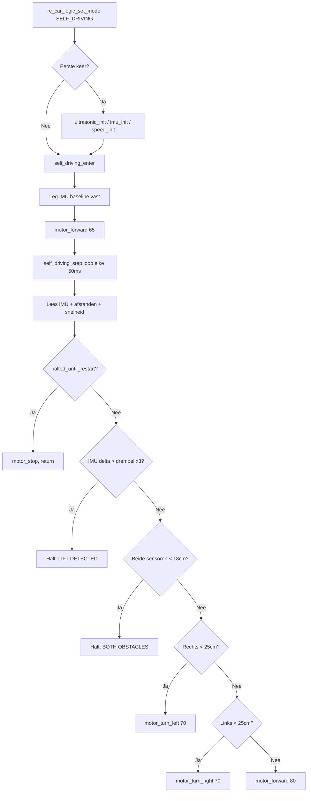

# Self-Driving Subsystem

## Overzicht
Het self-driving subsysteem zorgt voor autonome, obstakelbewuste beweging van de RC-auto op basis van ultrasone afstandsmeting, een MPU6050-gebaseerde IMU en wielencoder-feedback. Het is één van de twee runtime-modi van de RC-auto, naast Bluetooth/handmatige bediening.

## Doel
Dit document legt uit hoe self-driving mode wordt geïnitialiseerd, welke modules het gebruikt, hoe `self_driving_step()` bewegingsbeslissingen neemt en welke veiligheidsvoorwaarden het voertuig doen stoppen. Het richt zich op het geïmplementeerde gedrag in de firmware in plaats van geplande autonome functies.

## Runtime-positie
De firmware gaat naar self-driving mode via `rc_car_logic_set_mode(RC_CAR_MODE_SELF_DRIVING)`. Bij de eerste overgang naar deze mode initialiseert `rc_car_logic.c` de ultrasone sensoren, IMU-module en speedmodule lazy (alleen bij eerste keer), roept dan `self_driving_enter()` aan en schakelt de globale modus naar self-driving. Sensoren worden slechts één keer geïnitialiseerd — latere moduswissels hergebruiken de reeds geïnitialiseerde randapparatuur.

## Hoofdmodules
Het self-driving subsysteem bestaat uit vier hoofdbrondbestanden.

- `self_driving.c` bevat de hoog-niveau autonome regellus, bewegingsbeslissingen, IMU-basisdetectie en halt-statusbeheer.
- `ultrasonic.c` meet obstakelafstanden aan de linker- en rechterzijde met HC-SR04-sensoren.
- `imu.c` initialiseert de MPU6050, activeert motion-interrupts en leest accelerometer- en gyroscoopdata uit.
- `speed.c` telt wielencoder-pulsen en leidt hieruit afstandsgebaseerde snelheidsschattingen af voor links en rechts.

## Ingangspunten

| Functie | Beschrijving |
|---|---|
| `self_driving_enter()` | Reset status, legt IMU-baseline vast, start voorwaartse beweging |
| `self_driving_exit()` | Stopt motoren, wist alle statusvlaggen |
| `self_driving_step()` | Eén volledige meet-beslis-handel cyclus, elke 50 ms aangeroepen |
| `self_driving_is_halted()` | Geeft `true` terug wanneer de auto in persistente halt-status is |

## Startgedrag
Wanneer self-driving mode start, voert `self_driving_enter()` het volgende uit:
- Wist `Motion_Detected` en reset wielencoders
- Reset alle halt-vlaggen en debounce-tellers
- Legt een live IMU-meting vast als **baseline** (`base_ax`, `base_ay`, `base_az`) — later gebruikt om lift te detecteren ten opzichte van de werkelijke startoriëntatie van de auto
- Wist de terminal en drukt de statuskoptekst af
- Stuurt motoren vooruit met 65%

## Stopgedrag
`self_driving_exit()` stopt de motoren, wist halt-vlaggen en debounce-tellers, en drukt een exitmelding af.

## Regellus
`self_driving_step()` wordt herhaaldelijk aangeroepen vanuit de RC-car FreeRTOS-task zolang de globale modus self-driving is. Elke cyclus:

1. Leest IMU uit (ax, ay, az, gx, gy, gz)
2. Leest linker- en rechter ultrasone afstanden
3. Leest encoder-gebaseerde snelheidswaarden
4. Werkt terminalweergave bij (regels 2, 3, 4 op hun plaats — geen scrollen)
5. Controleert halt-status
6. Evalueert IMU-lift/crash-detectie
7. Evalueert obstakellogica
8. Geeft motorcommando
9. Wacht 50 ms

## Terminaluitvoer
Het subsysteem schrijft drie vaste regels naar de terminal met ANSI-escape-codes, die elke cyclus op hun plaats worden overschreven zonder scrollen:

| Regel | Inhoud |
|---|---|
| Regel 2 | Sensorstatus: afstanden, snelheden, encodertellingen, IMU-assen, motion-vlag |
| Regel 3 | Laatste eventmelding (obstakel, lift, halt, vrije baan) |
| Regel 4 | Volledige IMU-uitlezing inclusief gyro- en baseline-vergelijking |

## IMU-lift- en crashdetectie
In plaats van een vaste absolute drempel te gebruiken, vergelijkt `self_driving_step()` elke IMU-meting met de **bij opstart vastgelegde baseline** via delta-waarden:

```
dAX = ax - base_ax
dAY = ay - base_ay
dAZ = az - base_az
```

Als `|dAX| > 3000` of `|dAY| > 3000` of `|dAZ| > 2500`, wordt een debounce-teller (`imu_counter`) verhoogd. De teller moet **3 opeenvolgende detecties** bereiken voordat de auto stopt. Dit voorkomt fout-positieven door een enkele hobbel terwijl echte lifts en crashes nog worden opgevangen. De teller wordt teruggezet naar 0 zodra waarden weer normaal zijn.

Bij activering gaat de auto in `halted_until_restart` met een eventmelding die de delta-waarden toont. De interrupt-gebaseerde `Motion_Detected`-vlag wordt elke cyclus gewist omdat deze op deze hardware-opstelling fout-positieven veroorzaakte — in plaats daarvan wordt de baseline-delta-methode gebruikt.

## Halt-status
`halted_until_restart` is een persistente vlag die wordt gezet door zowel obstakel- als IMU-detectie. Zolang deze actief is:
- Motoren worden elke cyclus gestopt
- De halt-eventmelding wordt één keer afgedrukt
- De step-functie keert onmiddellijk terug zonder navigatielogica uit te voeren
- De vlag wordt alleen gewist door `self_driving_enter()` of `self_driving_exit()`

De X-knop op de Joy-Con (`btn0 = 0x02`) roept `self_driving_enter()` direct aan wanneer de auto gestopt is, waardoor de autonome werking wordt herstart zonder van modus te wisselen.

## Obstakelafhandeling

| Conditie | Actie |
|---|---|
| Beide sensoren < 18 cm | `motor_stop()`, ga naar `halted_until_restart` |
| Rechter sensor < 25 cm | `motor_turn_left(70)` |
| Linker sensor < 25 cm | `motor_turn_right(70)` |
| Beide vrij | `motor_forward(80)` |

De halt-drempel (18 cm) is smaller dan de draaidrempel (25 cm), wat een reactiezone geeft vóór volledige stop.

## Ultrasone meting
De ultrasone module gebruikt twee trigger/echo-paren:

| Sensor | Trigger | Echo |
|---|---|---|
| Rechts | P9_0 | P9_1 |
| Links | P9_4 | P9_5 |

Elke meting stuurt een 10 µs triggerpuls, meet de echopulsduur in microseconden en converteert naar centimeters via `duur × 0.0343 / 2`. Beide trigger-pinnen worden laag gehouden en krijgen 100 ms om te stabiliseren na `ultrasonic_init()`. Als de wachttijd of pulsbreedte 20 000 µs overschrijdt, geeft de driver 1000 cm terug (behandeld als vrije baan).

## Snelheidsschatting
De speedmodule gebruikt wielencoders op P9_6 (rechts) en P9_7 (links). Rising-edge GPIO-interrupts verhogen `Count_EncoderRight` en `Count_EncoderLeft`. Snelheid wordt afgeleid als:

```
afstand_m = aantal / 235.0
snelheid_kmh = afstand_m × 3.6
```

Dit geeft cumulatieve afstand sinds de laatste `reset_encoders()`-aanroep uitgedrukt als een km/h-equivalent, niet als momentane snelheid. Encoders worden elke keer gereset wanneer `self_driving_enter()` wordt aangeroepen.

## Motorinteractie
Het self-driving subsysteem gebruikt de gemeenschappelijke motorlaag:

| Functie | Effect |
|---|---|
| `motor_forward(80)` | Alle 4 wielen vooruit met 80% |
| `motor_turn_left(70)` | Wiel A+C op 70%, B+D gestopt |
| `motor_turn_right(70)` | Wiel B+D op 70%, A+C gestopt |
| `motor_stop()` | Alle 4 wielen op 0% |

`motor_forward()` bevat een soft-start-ramp van 20% omhoog in stappen van 5% met 20 ms ertussen, waardoor inschakelstroompieken worden voorkomen wanneer alle 4 motoren tegelijk starten op AA-batterijvoeding.

## Ondersteunde functionaliteit
Autonoom vooruitrijden, obstakelvermijding links en rechts, baseline-relatieve IMU-lift- en crashdetectie met 3-cyclus debounce, terminaldiagnostiek op 3 regels op hun plaats, persistente halt-status met X-knop herstart, encoder-telling, mode-entry en -exit.

## Beperkingen
Eenvoudige rule-based controller zonder padplanning, kartering of sensorfusie. Geen PID-gebaseerde sturing of closed-loop snelheidsregeling. Snelheidsfuncties meten cumulatieve afstand in plaats van momentane snelheid. De interrupt-gebaseerde IMU-bewegingsvlag is uitgeschakeld vanwege ruis op deze opstelling — baseline-delta-detectie wordt in plaats daarvan gebruikt.

## Self-driving flow

