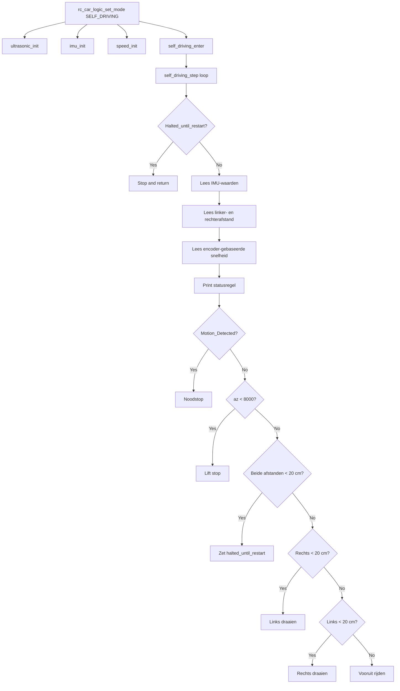

# Self-Driving Subsystem

## Overzicht
Het self-driving subsysteem zorgt voor autonome, obstakelbewuste beweging van de RC-auto op basis van ultrasoon afstandsmeting, een MPU6050-gebaseerde IMU en wielencoder-feedback. Het is één van de twee runtime modes van de RC-auto, naast Bluetooth/manuele bediening.

## Doel
Dit document legt uit hoe self-driving mode wordt geïnitialiseerd, welke modules gebruikt worden, hoe `self_driving_step()` beslissingen neemt en welke veiligheidsvoorwaarden het voertuig doen stoppen. De focus ligt op het gedrag dat effectief in de firmware geïmplementeerd is.

## Plaats in runtime
De firmware activeert self-driving mode via `rc_car_logic_set_mode(RC_CAR_MODE_SELF_DRIVING)`. Bij de eerste overgang naar deze mode initialiseert `rc_car_logic.c` de ultrasonic-sensoren, de IMU-module en de speedmodule, roept daarna `self_driving_enter()` aan en zet vervolgens de globale mode op self-driving.

## Belangrijkste modules
Het self-driving subsysteem bestaat uit vier hoofdmodules.

- `self_driving.c` bevat de hoog-niveau autonome regellus en de rijbeslissingen.
- `ultrasonic.c` meet obstakelafstanden aan de linker- en rechterzijde.
- `imu.c` initialiseert de MPU6050, activeert motion interrupts en leest accelerometer- en gyroscoopdata uit.
- `speed.c` telt encoderpulsen van de wielen en leidt hieruit afstandsgebaseerde snelheidswaarden af voor links en rechts.

## Ingangspunten
De API van de self-driving regeling bestaat uit `self_driving_enter()`, `self_driving_exit()`, `self_driving_step()` en `self_driving_is_halted()`. `self_driving_enter()` bereidt het subsysteem voor op autonoom rijden, `self_driving_exit()` stopt de beweging en reset de halt-status, en `self_driving_step()` voert één volledige meet- en besliscyclus uit.

## Gedrag bij starten en stoppen
Wanneer self-driving mode start, wist `self_driving_enter()` de waarde van `Motion_Detected`, reset het de wielencoders, wist interne halt-flags, print een modemelding en laat de motoren vooruit rijden met waarde 65. Wanneer de mode verlaten wordt, stopt `self_driving_exit()` de motoren, wist de halt-flags en print een exitmelding.

## Regellus
`self_driving_step()` wordt herhaaldelijk aangeroepen vanuit de RC-car task zolang de globale mode self-driving is. In elke cyclus controleert de functie eerst of het subsysteem gehalt is, leest daarna IMU-waarden, leest linker- en rechterafstand, leest encoder-gebaseerde snelheidswaarden, print een geformatteerde statuslijn, evalueert veiligheidsvoorwaarden en beslist vervolgens of de auto moet stoppen, draaien of vooruitrijden.

## Obstakelafhandeling
De obstakellogica gebruikt twee ultrasone metingen, één rechts en één links. Als beide gemeten afstanden kleiner zijn dan 20 cm, stopt het voertuig, gaat het in een halt-status en blijft het stilstaan tot een herstartconditie deze toestand opheft. Als alleen rechts geblokkeerd is, draait de auto links met commando 80, en als alleen links geblokkeerd is, draait de auto rechts met dezelfde waarde. Als geen van beide zijden onder de drempel ligt, blijft de auto vooruit rijden met commando 65.

## Halt-gedrag
Het self-driving subsysteem bewaart een persistente halt-status via `halted_until_restart`. Terwijl deze toestand actief is, dwingt `self_driving_step()` de motoren om te stoppen, print het éénmalig een haltmelding, wacht het 50 ms en keert het terug zonder de normale navigatielogica uit te voeren. De helper `self_driving_is_halted()` maakt deze status ook beschikbaar voor andere code.

## IMU-veiligheidsgedrag
De IMU-laag gebruikt een MPU6050 die via I2C verbonden is met `IMU_SDA` op `P6_1`, `IMU_SCL` op `P6_0` en een interruptlijn op `P10_5`. Tijdens de initialisatie maakt de code de MPU6050 actief, controleert de `WHO_AM_I`-registerwaarde tegen de verwachte waarde `0x68` en activeert daarna motion-detection interrupts. Wanneer een motion interrupt optreedt, stopt de ISR de motoren en zet `Motion_Detected` op true, waardoor `self_driving_step()` in de volgende cyclus een noodstop uitvoert.

## Lift detection
Naast de interrupt-gebaseerde stop controleert de regellus ook de Z-asversnelling `az` na elke IMU-uitlezing. Als `az` kleiner is dan 8000, behandelt de code dit als een liftsituatie, stopt de motoren en print een lift-detected melding. Dit vormt een tweede veiligheidsmechanisme tegen het optillen of onverwacht kantelen van de auto.

## Ultrasone meting
De ultrasonic-module gebruikt twee trigger- en echo-paren: rechter trigger `P9_0` met rechter echo `P9_1`, en linker trigger `P9_4` met linker echo `P9_5`. Elke meting stuurt een korte triggerpuls, meet hoe lang de echolijn hoog blijft en zet deze pulstijd om naar centimeters via de berekening in de driver. Als de wachttijd of pulsbreedte de timeout overschrijdt, retourneert de driver een grote fallbackafstand van 1000 cm.

## Snelheidsbepaling
De speedmodule gebruikt wielencoder-ingangen op `P9_6` en `P9_7`. Rising-edge GPIO interrupts verhogen `Count_EncoderRight` en `Count_EncoderLeft`, en de gerapporteerde waarden worden afgeleid uit deze tellers via `COUNTS_PER_METER` met waarde `235.0`. De functies `get_speed_right_kmh()` en `get_speed_left_kmh()` zetten geaccumuleerde afstand om naar km/h, maar in de huidige code wordt niet gedeeld door verstreken tijd, waardoor deze waarden eerder afstandsgebaseerde indicatoren zijn dan echte tijdgenormaliseerde snelheidsmetingen.

## Interactie met de motorlaag
Het self-driving subsysteem vertrouwt op de gemeenschappelijke motorlaag om beslissingen uit te voeren. `motor_forward()` activeert alle vier PWM-uitgangen, `motor_stop()` zet alle duty cycles op nul, `motor_turn_left()` activeert enkel motoren A en C, en `motor_turn_right()` activeert enkel motoren B en D. De motorpinnen zijn in `pins.h` toegewezen aan `P10_0` tot en met `P10_3`.

## Logging en diagnose
`self_driving_step()` bouwt en print een live statuslijn met rechter- en linkerafstand, rechter- en linkersnelheid, encodertellers, accelerometerwaarden en de `Motion_Detected`-flag. Dit geeft tijdens debugging en testen een bruikbaar realtime beeld van de autonome toestand.

## Ondersteunde functionaliteit
De huidige implementatie ondersteunt autonoom vooruitrijden, obstakelvermijding met linker- en rechter ultrasoonsensoren, noodstop bij motion interrupt, lift detection via de Z-asdrempel, encodertelling, mode entry en exit, en een persistente halt-toestand wanneer beide zijden geblokkeerd zijn. Het subsysteem is nauw gekoppeld aan de RC car mode manager zodat het alleen actief is wanneer self-driving mode geselecteerd is.

## Beperkingen
De huidige implementatie gebruikt een eenvoudige rule-based controller en geen path planning, mapping of sensor fusion. Er is geen routegeheugen, geen doellogica, geen geleidelijke snelheidsregeling en geen aanwijzing van PID-gebaseerde stuurregeling of closed-loop velocity control in de aangeleverde code. De gerapporteerde snelheidsfuncties berekenen bovendien geen snelheid over tijd, wat hun nauwkeurigheid als fysieke snelheidsmeting beperkt.

## Self-driving flow
