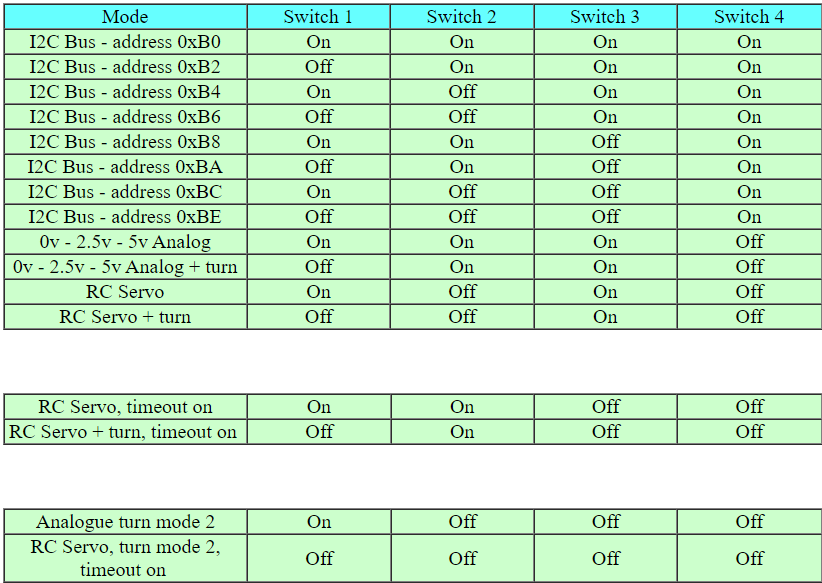
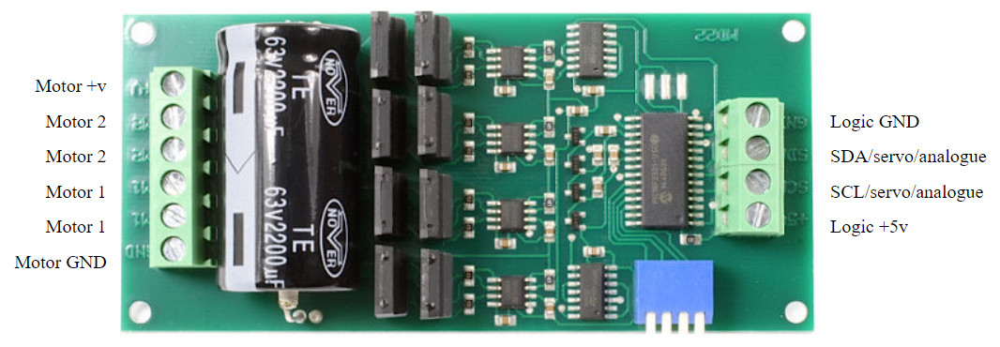
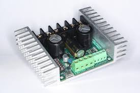
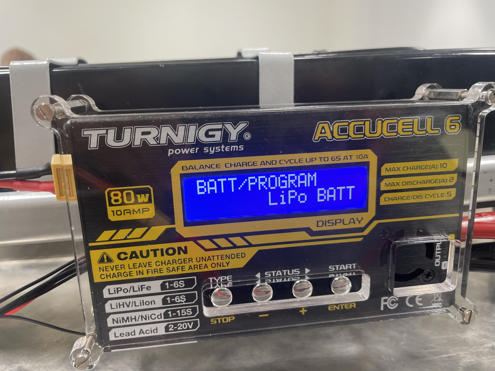
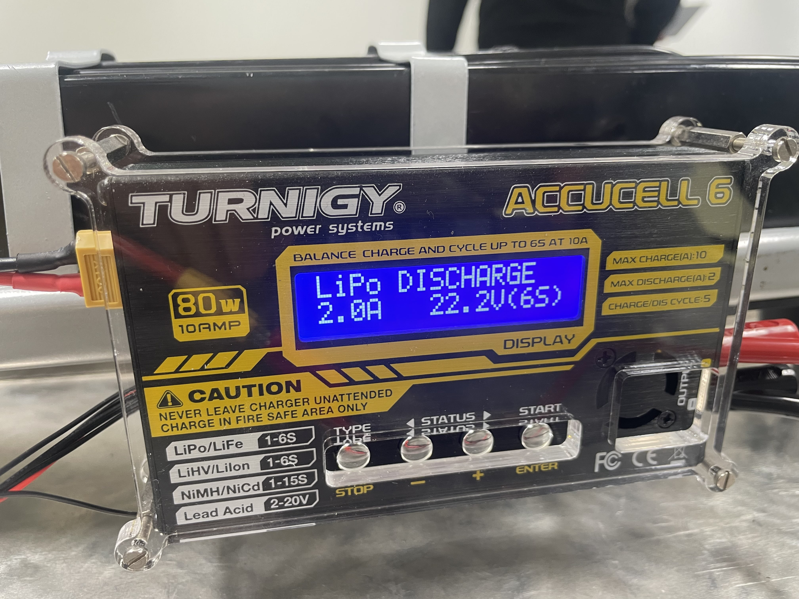
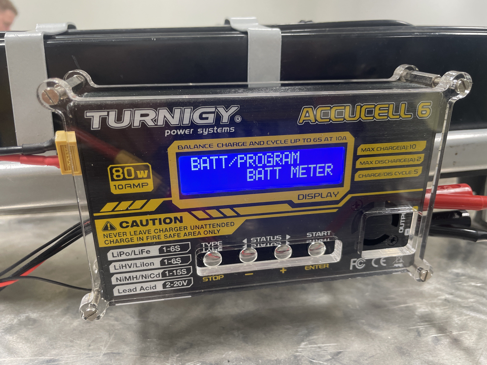
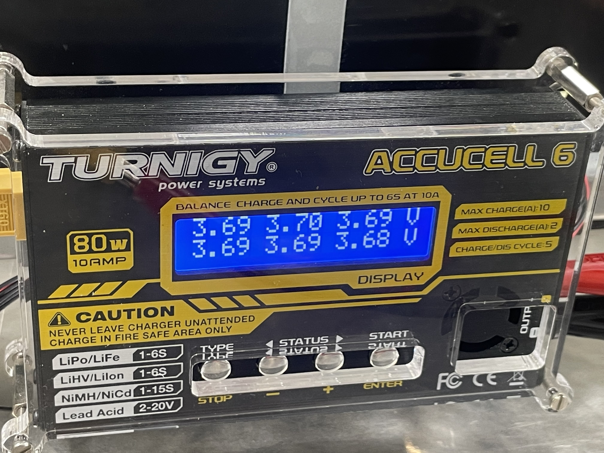

# 🛠️ Hardware Specification & Bill of Materials (BOM)

Dit document bevat de definitieve hardwareconfiguratie, pin-toewijzungen, kritieke voedingsspecificaties en de componentenlijst voor de **Mini RC Car**, de **2-Wheel RC Car** en de **RC Cart (AGV)**.

---

## 1. Productlijn Architectuur Overview

Het project is onderverdeeld in drie specifieke hardware-architecturen gebaseerd op de Familie van de Infineon PSoC 6 microcontroller:

1. **Mini RC Car (Pioneer Kit - CY8CKIT-062-WIFI-BT)**: 4-wielig testplatform met de **L9110S** motor driver. Werkt via Bluetooth (handmatig) of autonoom via sensorbuilds.
2. **2-Wheel RC Car (Proto Kit - CY8CPROTO-062-4343W)**: Compacte, sensorloze 'light' versie van de grote AGV. Maakt gebruik van 2 wielen en de **L298N** motor driver. Volledig draadloos aangestuurd via Bluetooth.
3. **RC Cart AGV (Proto Kit - CY8CPROTO-062-4343W)**: Het zware industriële platform. Aangedreven door twee **MY1018** motoren en de **MD22** high-power motor driver. Volledig draadloos aangestuurd via Bluetooth.

---

## 2. Bill of Materials (BOM) & Datasheets

| Component | Type / Model | Functie | Lokale Datasheet Link | Aantal | Toegepast in |
| :--- | :--- | :--- | :--- | :--- | :--- |
| **Microcontroller** | Infineon PSoC 6 | Hoofdcontroller (Proto Kit base) | [PSoC6_Proto.pdf](/docs/datasheets/infineon-cy8cproto-062-4343w-psoc-6-wi-fi-bt-prototyping-kit-guide-usermanual-en.pdf) | 1 | RC Cart (AGV) / 2 Wheel RC Car |
| **Development Kit** | CY8CKIT-062-WIFI-BT | PSoC 6 WiFi-BT Pioneer Kit base | [Pioneer_Kit_Guide.pdf](/docs/datasheets/infineon-cy8ckit-062-wifi-bt-psoc-6-wifi-bt-pioneer-kit-guide-usermanual-en.pdf) | 1 | Mini RC Car |
| **Motor Driver (Mini)**| L9110S | Dual-Channel H-Bridge Driver | [L9110S_motor_driver.pdf](/docs/datasheets/L9110S_motor_driver.pdf) | 4 | Mini RC Car |
| **Motor Driver (2-Wheel)**| L298N | Dual H-Bridge met 5V BEC Output | [L298N_Motor_Driver.pdf](/docs/datasheets/L298N_Motor_Driver.pdf) | 1 | 2 Wheel RC Car |
| **Motor Driver (AGV)** | Sabertooth 2x32A | Regeneratieve Dual Motor Driver | [Sabertooth2x32.pdf](/docs/datasheets/Sabertooth2x32.pdf) | 1 | RC Cart (AGV) |
| **DC-DC Converter** | SBC-BUCK01 | Step-down spanningstabilisatie logica AGV | [SBCBUCK01.pdf](/docs/datasheets/SBCBUCK01.pdf) | 1 | RC Cart (AGV) |
| **Accu Lader** | Turnigy Accucell 6 | Balanceer lader voor LiPo accupacks | [Accucell_6.pdf](/docs/datasheets/Accucell_6.pdf) | 2 | RC Cart (AGV) |
| **Snelheidssensor** | SEN-SPEED | Hall-effect encoder voor wielsnelheid | [SEN-SPEED.pdf](/docs/datasheets/SEN-SPEED.pdf) | 2 | Mini RC Car |
| **Line Tracker** | KY-033 | Infrarood Lijnvolging | [KY-033.pdf](/docs/datasheets/p587610-KY-033-Joy-IT.pdf) | 2 | Mini RC Car (Versie 2) |
| **DC Motor (AGV)** | MY1018 | 24V Krachtige DC-motor met reductie | *Zie Sabertooth spec* | 2 | RC Cart (AGV) |
| **DC Motor (2 Wheel)** | Standaard DC | 6V Aandrijving wielen | *N.v.t.* | 2 | 2 Wheel RC Car |
| **DC Motor (Mini)** | Standaard DC | 6V Aandrijving wielen | *N.v.t.* | 4 | Mini RC Car |
| **Ultrasoon Sensor** | HC-SR04 | Afstandsmeting & Obstakeldetectie | [HCSR04.pdf](/docs/datasheets/HCSR04.pdf) | 2 | Mini RC Car (Versie 1) |
| **Draadloze Controller**| Joy-Con / DualShock| Handmatige HID-besturing via BT | *N.v.t.* | 1 | Alle drie |

---

## 3. Microcontroller Pin Mapping 

### 3.1 PSoC6 CY8CKIT-062-WIFI-BT (Mini RC Car)
| Perifeer Subsysteem | Signaal | PSoC6 Pin | Richting (I/O) | Versie / Toepassing |
| :--- | :--- | :--- | :--- | :--- |
| **UART (Debug/Log)** | TX | **P5_1** | Output | Alle builds |
| **UART (Debug/Log)** | RX | **P5_0** | Input | Alle builds |
| **Aandrijving (PWM)** | Motor A PWM / IN1 | **P10_0** | Output | L9110S Aansturing |
| **Aandrijving (PWM)** | Motor B PWM / IN2 | **P10_1** | Output | L9110S Aansturing |
| **Aandrijving (PWM)** | Motor C PWM / IN3 | **P10_2** | Output | L9110S Aansturing (4WD) |
| **Aandrijving (PWM)** | Motor D PWM / IN4 | **P10_3** | Output | L9110S Aansturing (4WD) |
| **Ultrasoon / IMU** | Sensoren pinnen | **P9_0, P9_1, P9_4, P9_5** | Gecombineerd| Versie 1 (Autonoom) |
| **Lijnvolgers** | Line Left / Right | **P10_4, P10_5, P10_6** | Input | Versie 2 (Line Tracker) |
| **Encoders (Snelheid)** | Speed Sensor R / L | **P9_6, P9_7** | Input (IRQ) | Beide Mini Versies |
| **User Interface** | Status LED | **P13_7** | Output | Alle builds |

### 3.2 PSoC6 CY8CPROTO-062-4343W (2 Wheel RC Car & RC Cart)
| Perifeer Subsysteem | Signaal | PSoC6 Pin | Richting (I/O) | Toepassing |
| :--- | :--- | :--- | :--- | :--- |
| **Draadloos (BT)** | Ingebouwde Antenne | **Intern (4343W)** | I/O | Bluetooth HID Besturing (Beide) |
| **Power (2-Wheel)** | L298N 5V Out | **J8 (Micro USB)** | Voeding Input | Gevoed via L298N Regulator (2-Wheel) |
| **Power (Cart)** | SBC-BUCK01 Out | **VBACK / GND** | Voeding Input | Gevoed via Buck Converter (Cart) |
| **UART (Debug/Log)** | TX / RX | **P5_1 / P5_0** | I/O | Debug & Telemetrie |
| **Aandrijving (2-Wheel)**| L298N EN A / EN B | **P9_6  / P9_7** | Output | Snelheidscontrole (2-Wheel) |
| **Aandrijving (2-Wheel)**| L298N IN1 t/m IN4 | **P9_0, P9_1, P9_2, P9_4**| Output | Richtingscontrole (2-Wheel) |
| **Aandrijving (Cart)** | Sabertooth M1 PWM | **N.v.t.** | Output | Snelheid/Richting Motor 1 (Cart) |
| **Aandrijving (Cart)** | Sabertooth M2 PWM | **N.v.t.** | Output | Snelheid/Richting Motor 2 (Cart) |
| **User Interface** | Status LED | **P13_7** | Output | Systeemstatus Indicator |

---

## 4. Elektrische & Voedingsspecificaties

### Mini RC Car (Pioneer Kit Base)
* **Logica:** 3.3V DC via USB-Powerbank.
* **Vermogen:** 5.0V DC via powerbank voor de L9110S driver en 4 DC-motoren.

### 2 Wheel RC Car (Proto Kit Base)
* **Logica:** 3.3V DC via micro-USB link.
* **Vermogen:** 8S 1.5V DC batterijen direct verbonden met de L298N motor driver om 2 standaard DC-motoren aan te sturen. Draait volledig op Bluetooth via de Joy-Con/DualShock.

### RC Cart / AGV (Proto Kit Base)
* **Logische Spanning (MCU):** De **SBC-BUCK01 DC-DC converter** tapt spanning af van het hoofdaccupack en reguleert dit stabiel naar de Proto Kit logica via de voedingspinnen. De USB-poort is hierdoor vrij en wordt ontlast tijdens operatie.
* **Vermogensspanning (Motoren):** High-power 24V DC circuit geleverd door twee LiPo-batterijen (gebalanceerd geladen met twee **Accucell 6** laders). Dit circuit voedt direct de krachtige **MD22** motor driver en de twee zware **MY1018** motoren.
* **Aansturingsmethodiek:** De Proto Kit verwerkt Bluetooth-commando's en stuurt twee onafhankelijke PWM-kanalen naar de Sabertooth signaalingangen (S1 en S2) om differentiële besturing (sturen en rijden) te realiseren.

---

## 5. Specificatie RC CarT

### MD22 Motor Driver
Dit zijn de verschillende configuratiemogelijkheden van de **MD22**. Binnen dit project is de driver ingesteld op de modus **ON - ON - ON - OFF**, wat correspondeert met de analoge aansturing (0V - 2,5V - 5V).

Hieronder is de **MD22** met de bijbehorende aansluitingen weergegeven:

---

### Sabertooth 2x32A
Vanwege een defect aan de **MD22** is er gezocht naar een geschikte vervangende motordriver. Na een marktinventarisatie is de keuze gevallen op de Sabertooth-productlijn. De Sabertooth is een industriële motordriver die moderner is en over superieure ingebouwde beveiligingen beschikt ten opzichte van de MD22.

Tijdens de selectieprocedure zijn de Sabertooth 2x25A V2 en de 2x32A als primaire opties overwogen. Aangezien de 2x25A V2 online niet leverbaar bleek, is er uiteindelijk gekozen voor de 2x32A-uitvoering. Hoewel deze variant een aanzienlijke overcapaciteit biedt voor deze toepassing, garandeert de zwaardere specificatie dat eventuele stroompieken probleemloos worden opgevangen.

Door onvoorziene logistieke vertragingen is deze motordriver echter niet tijdig geleverd. Bij gebrek aan een functionerende driver is het helaas niet mogelijk geweest om de RC Cart binnen de gestelde deadline volledig operationeel op te leveren.

---

### Accucell 6
Hieronder volgt de technische handleiding voor de configuratie en ingebruikname van de Accucell 6-acculader.

#### 1. Voeding en aansluiting
Om de lader te activeren, dient de ingang van de Accucell te worden gevoed met een stabiele gelijkspanning van **12V - 18V DC**. Dit levert het benodigde vermogen om het laadproces te faciliteren.

Zodra de accu via de 6-pins balanceerheader wordt gekoppeld, detecteert de Accucell 6 automatisch de configuratie van de cellen (in dit specifieke geval een **6S-accu**).

#### 2. Accutype selecteren
Vervolgens dient het correcte accutype in het menu te worden geselecteerd. Aangezien er binnen dit project gebruik wordt gemaakt van een **LiPo-accu**, kiest u voor de optie 'LiPo'.

#### 3. Laadprogramma initiëren
Selecteer daarna het gewenste programma. Om de accu op te laden, kiest u voor de modus **CHARGE**. 

*(Onderstaande afbeelding toont ter referentie het LiPo DISCHARGE-menu; het laadscherm is identiek van opzet, maar geeft de tekst `LiPo CHARGE` weer)*

Houd de **Enter-knop** langdurig ingedrukt om het geselecteerde programma te starten. Na activering worden de verstreken tijd en de actuele spanning realtime op het display weergegeven.

#### 4. Celspanning controleren (Battery Meter)
Indien u de accu niet wenst op te laden, maar enkel de actuele status wilt uitlezen, navigeert u in het hoofdmenu met de richtingtoetsen naar de **Battery Meter** (in plaats van het LiPo-laadprogramma).

Druk vervolgens op **Enter**. Het display toont direct een nauwkeurig overzicht van de spanning per individuele cel.

