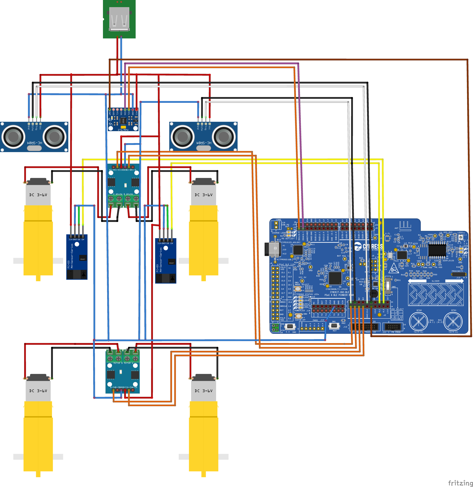
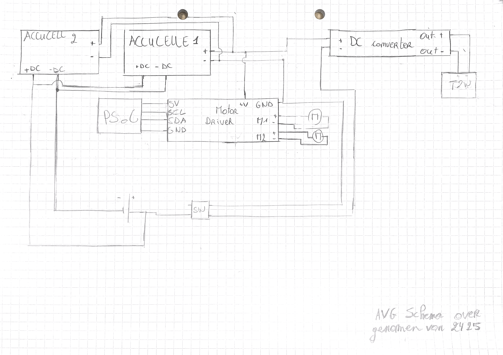

# 🛠️ Hardware Specification & Bill of Materials (BOM)

Dit document bevat de definitieve hardwareconfiguratie, pin-toewijzungen, kritieke voedingsspecificaties en de componentenlijst voor de **Mini RC Car**, de **2-Wheel RC Car** en de **RC Cart (AGV)**.

---

## 1. Productlijn Architectuur Overview

Het project is onderverdeeld in drie specifieke hardware-architecturen gebaseerd op de Familie van de Infineon PSoC 6 microcontroller:

1. **Mini RC Car (Pioneer Kit - CY8CKIT-062-WIFI-BT)**: 4-wielig testplatform met de **L9110S** motor driver. Werkt via Bluetooth (handmatig) of autonoom via sensorbuilds.
2. **2-Wheel RC Car (Proto Kit - CY8CPROTO-062-4343W)**: Compacte, sensorloze 'light' versie van de grote AGV. Maakt gebruik van 2 wielen en de **L298N** motor driver. Volledig draadloos aangestuurd via Bluetooth.
3. **RC Cart AGV (Proto Kit - CY8CPROTO-062-4343W)**: Het zware industriële platform. Aangedreven door twee **MY1018** motoren en de **Sabertooth 2x32A** high-power motor driver. Volledig draadloos aangestuurd via Bluetooth.

---

## 2. Bill of Materials (BOM) & Datasheets

| Component | Type / Model | Functie | Lokale Datasheet Link | Aantal | Toegepast in |
| :--- | :--- | :--- | :--- | :--- | :--- |
| **Microcontroller** | Infineon PSoC 6 | Hoofdcontroller (Proto Kit base) | [PSoC6_Proto.pdf](/docs/datasheets/infineon-cy8cproto-062-4343w-psoc-6-wi-fi-bt-prototyping-kit-guide-usermanual-en.pdf) | 1 | RC Cart (AGV) / 2 Wheel RC Car |
| **Development Kit** | CY8CKIT-062-WIFI-BT | PSoC 6 WiFi-BT Pioneer Kit base | [Pioneer_Kit_Guide.pdf](/docs/datasheets/infineon-cy8ckit-062-wifi-bt-psoc-6-wifi-bt-pioneer-kit-guide-usermanual-en.pdf) | 1 | Mini RC Car |
| **Motor Driver (Mini)**| L9110S | Dual-Channel H-Bridge Driver | [L9110S_motor_driver.pdf](/docs/datasheets/L9110S_motor_driver.pdf) | 1 | Mini RC Car |
| **Motor Driver (2-Wheel)**| L298N | Dual H-Bridge met 5V BEC Output | [L298N_Motor_Driver.pdf](/docs/datasheets/L298N_Motor_Driver.pdf) | 1 | 2 Wheel RC Car |
| **Motor Driver (AGV)** | Sabertooth 2x32A | Regeneratieve Dual Motor Driver | [Sabertooth2x32.pdf](/docs/datasheets/Sabertooth2x32.pdf) | 1 | RC Cart (AGV) |
| **DC-DC Converter** | SBC-BUCK01 | Step-down spanningstabilisatie logica AGV | [SBCBUCK01.pdf](/docs/datasheets/SBCBUCK01.pdf) | 1 | RC Cart (AGV) |
| **Accu Lader** | Turnigy Accucell 6 | Balanceer lader voor LiPo accupacks | [Accucell_6.pdf](/docs/datasheets/Accucell_6.pdf) | 2 | RC Cart (AGV) |
| **Snelheidssensor** | SEN-SPEED | Hall-effect encoder voor wielsnelheid | [SEN-SPEED.pdf](/docs/datasheets/SEN-SPEED.pdf) | 2 | Mini RC Car |
| **DC Motor (AGV)** | MY1018 | 24V Krachtige DC-motor met reductie | *Zie Sabertooth spec* | 2 | RC Cart (AGV) |
| **DC Motor (2 Wheel)** | Standaard DC | 6V Aandrijving wielen | *N.v.t.* | 2 | 2 Wheel RC Car |
| **DC Motor (Mini)** | Standaard DC | 6V Aandrijving wielen | *N.v.t.* | 4 | Mini RC Car |
| **Ultrasoon Sensor** | HC-SR04 | Afstandsmeting & Obstakeldetectie | [HCSR04.pdf](/docs/datasheets/HCSR04.pdf) | 2 | Mini RC Car (Versie 1) |
| **Line Tracker** | KY-033 | Infrarood Lijnvolging | [KY-033.pdf](/docs/datasheets/p587610-KY-033-Joy-IT.pdf) | 2 | Mini RC Car (Versie 2) |
| **Draadloze Controller**| Joy-Con / DualShock| Handmatige HID-besturing via BT | *N.v.t.* | 1 | Alle drie |

---

## 3. Microcontroller Pin Mapping 

### 3.1 PSoC6 CY8CKIT-062-WIFI-BT (Mini RC Car)
| Perifeer Subsysteem | Signaal | PSoC6 Pin | Richting (I/O) | Versie / Toepassing |
| :--- | :--- | :--- | :--- | :--- |
| **UART (Debug/Log)** | TX | **P5_1** | Output | Alle builds |
| **UART (Debug/Log)** | RX | **P5_0** | Input | Alle builds |
| **Aandrijving (PWM)** | Motor A PWM / IN1 | **P10_0** | Output | L9110S Aansturing |
| **Aandrijving (PWM)** | Motor B PWM / IN2 | **P10_1** | Output | L9110S Aansturing |
| **Aandrijving (PWM)** | Motor C PWM / IN3 | **P10_2** | Output | L9110S Aansturing (4WD) |
| **Aandrijving (PWM)** | Motor D PWM / IN4 | **P10_3** | Output | L9110S Aansturing (4WD) |
| **Ultrasoon / IMU** | Sensoren pinnen | **P9_0, P9_1, P9_4, P9_5** | Gecombineerd| Versie 1 (Autonoom) |
| **Lijnvolgers** | Line Left / Right | **P9_2, P9_3** | Input | Versie 2 (Line Tracker) |
| **Encoders (Snelheid)** | Speed Sensor R / L | **P9_6, P9_7** | Input (IRQ) | Beide Mini Versies |
| **User Interface** | Status LED | **P13_7** | Output | Alle builds |

### 3.2 PSoC6 CY8CPROTO-062-4343W (2 Wheel RC Car & RC Cart)
| Perifeer Subsysteem | Signaal | PSoC6 Pin | Richting (I/O) | Toepassing |
| :--- | :--- | :--- | :--- | :--- |
| **Draadloos (BT)** | Ingebouwde Antenne | **Intern (4343W)** | I/O | Bluetooth HID Besturing (Beide) |
| **Power (2-Wheel)** | L298N 5V Out | **J8 (Micro USB)** | Voeding Input | Gevoed via L298N Regulator (2-Wheel) |
| **Power (Cart)** | SBC-BUCK01 Out | **VBACK / GND** | Voeding Input | Gevoed via Buck Converter (Cart) |
| **UART (Debug/Log)** | TX / RX | **P5_1 / P5_0** | I/O | Debug & Telemetrie |
| **Aandrijving (2-Wheel)**| L298N EN A / EN B | **P10_0 / P10_1** | Output | Snelheidscontrole (2-Wheel) |
| **Aandrijving (2-Wheel)**| L298N IN1 t/m IN4 | **P10_2 t/m P10_5**| Output | Richtingscontrole (2-Wheel) |
| **Aandrijving (Cart)** | Sabertooth M1 PWM | **P10_0** | Output | Snelheid/Richting Motor 1 (Cart) |
| **Aandrijving (Cart)** | Sabertooth M2 PWM | **P10_1** | Output | Snelheid/Richting Motor 2 (Cart) |
| **User Interface** | Status LED | **P13_7** | Output | Systeemstatus Indicator |

---

## 4. Elektrische & Voedingsspecificaties

### Mini RC Car (Pioneer Kit Base)
* **Logica:** 3.3V DC via USB-Powerbank.
* **Vermogen:** 6.0V DC via batterijpack voor de L9110S driver en 4 DC-motoren.

### 2 Wheel RC Car (Proto Kit Base)
* **Logica:** 3.3V DC via micro-USB link.
* **Vermogen:** 6.0V DC rail direct verbonden met de L298N motor driver om 2 standaard DC-motoren aan te sturen. Draait volledig op Bluetooth via de Joy-Con/DualShock.

### RC Cart / AGV (Proto Kit Base)
* **Logische Spanning (MCU):** De **SBC-BUCK01 DC-DC converter** tapt spanning af van het hoofdaccupack en reguleert dit stabiel naar de Proto Kit logica via de voedingspinnen. De USB-poort is hierdoor vrij en wordt ontlast tijdens operatie.
* **Vermogensspanning (Motoren):** High-power 24V DC circuit geleverd door twee LiPo-batterijen (gebalanceerd geladen met twee **Accucell 6** laders). Dit circuit voedt direct de krachtige **MD22** motor driver en de twee zware **MY1018** motoren.
* **Aansturingsmethodiek:** De Proto Kit verwerkt Bluetooth-commando's en stuurt twee onafhankelijke PWM-kanalen (`P10_0` en `P10_1`) naar de Sabertooth signaalingangen (S1 en S2) om differentiële besturing (sturen en rijden) te realiseren.

---

## 5. Systeemschema's & Architectuur

### Mini RC Car Elektrisch Schema
Dit schema toont de interfacing tussen de Pioneer Kit, de L9110S driver, de HC-SR04 sensoren, de IMU/Line Trackers en de 4 low-power DC-motoren.

### RC Cart (AGV) Blokdiagram
Dit schema illustreert de hoog-vermogen architectuur: de Proto Kit stuurt via de SBC-BUCK01 gereguleerde spanning aan, de dubbele LiPo-voeding, de Bluetooth-ontvangst via de 4343W-module, en hoe de MD22 driver de zware MY1018 motoren controleert.

### 2 Wheel RC Car Blokdiagram
Dit schema illustreert de hoog-vermogen architectuur: de Proto Kit stuurt via de SBC-BUCK01 gereguleerde spanning aan, de dubbele LiPo-voeding, de Bluetooth-ontvangst via de 4343W-module, en hoe de MD22 driver de zware MY1018 motoren controleert.
